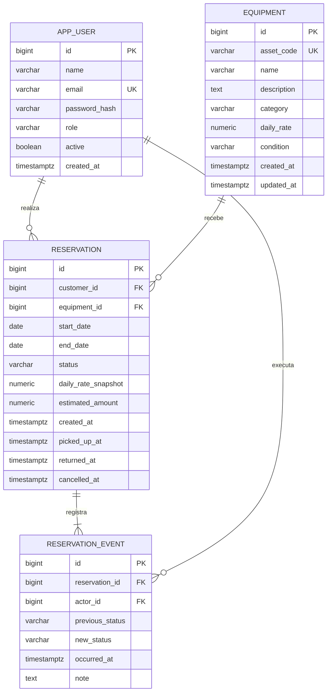
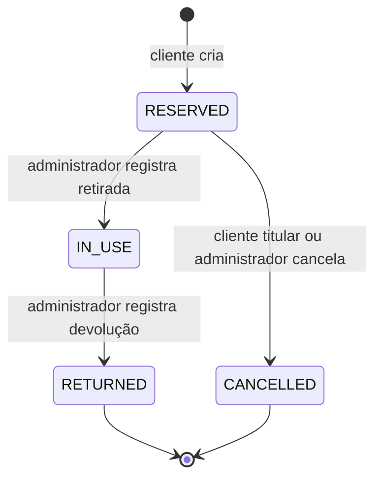

# Planejamento do EquipRent

## 1. Objetivo e limites

Organizar a locação de equipamentos de uma pequena empresa, substituindo controles dispersos por um catálogo de unidades físicas, reservas por período e histórico de retirada e devolução. O projeto deve demonstrar fundamentos de desenvolvimento web, integridade de dados, autorização e testes em entrevistas de estágio e nível júnior.

**Entrega atual:** estrutura executável, página inicial e este planejamento. As entidades, regras, telas e rotas descritas a seguir são propostas para as próximas etapas; ainda não estão implementadas.

### Primeira versão

- Autenticação com perfis `ADMIN` e `CLIENTE`.
- Cadastro de clientes e equipamentos: nome, descrição, categoria, código individual e diária.
- Disponibilidade por período, criação e cancelamento de reservas de um único equipamento.
- Estimativa do aluguel com diária histórica, retirada, devolução e identificação de atraso.
- Histórico de reservas e movimentações com autor e instante da operação.
- Manutenção, preservação de registros e desativação em vez de exclusão de históricos.
- Busca, filtros, paginação e interface responsiva em português.

**Fora da primeira versão:** pagamentos, multas automáticas, e-mails, várias empresas, aplicativos móveis, carrinho com vários equipamentos, agendamento de manutenção, prorrogação e reprogramação de reservas. Uma reserva não terá seus dias editados: cancelar e reservar novamente evita reprecificação e transições ambíguas.

## 2. Arquitetura e decisões técnicas

Monólito Spring Boot com Spring MVC e páginas Thymeleaf. Um processo Java e um PostgreSQL. Bootstrap local para o layout, sem build JavaScript obrigatório. Java 21 e Spring Boot 4.1.2, cuja compatibilidade foi confirmada na [documentação oficial](https://docs.spring.io/spring-boot/system-requirements.html) em 27/10/2026.

Organização **por funcionalidade**, mantendo classes pequenas e papéis explícitos. Não criar interfaces de service sem necessidade, controllers genéricos, repositórios base próprios ou camadas que só repassem chamadas.

```text
com.equiprent
  EquipRentApplication
  home/
    HomeController                         # existe
  user/                                    # futuro
    User, UserRole, UserRepository
    UserService, UserController, UserForm
  equipment/                               # futuro
    Equipment, EquipmentCondition, EquipmentCategory
    EquipmentRepository, EquipmentService, EquipmentController
    EquipmentForm, EquipmentSummary
  reservation/                             # futuro
    Reservation, ReservationStatus, ReservationEvent
    ReservationRepository, ReservationEventRepository
    ReservationService, AvailabilityService, ReservationController
    ReservationForm, ReservationSummary
  security/                                # futuro
    SecurityConfig, CustomUserDetailsService
  shared/                                  # somente quando necessário
    configuração de Clock e tratamento de erros comuns

resources/templates/{home,user,equipment,reservation}/
resources/static/{css,vendor}/
resources/db/migration/V1__create_initial_schema.sql  # somente na modelagem
```

O controller recebe formulários, valida entradas e escolhe a view. O service aplica regras, autorização por proprietário e transações. O repository consulta e persiste. Entidades representam o estado persistente; formulários não recebem campos como papel, proprietário ou preço histórico do navegador. Objetos de saída são introduzidos quando necessários para montar views sem consultas fora do service.

Flyway controla o esquema e Hibernate apenas o valida (`ddl-auto=validate`). `open-in-view=false` torna explícito o carregamento dos dados antes da renderização. Não expor entidades diretamente como contratos de entrada. Usar `jakarta.validation` nos formulários quando a dependência for adicionada.

**Por que isso é explicável em uma entrevista:** a arquitetura acompanha a complexidade de uma empresa pequena; mantém regras testáveis em services, usa transações reais para concorrência e renderiza HTML no servidor sem duplicar a aplicação em duas tecnologias.

## 3. Modelo de dados proposto

IDs `Long` gerados no banco. Nomes de tabelas em inglês, evitando `user` como nome SQL reservado: usar `app_user`. Enums persistidos como texto (`EnumType.STRING`), com restrições SQL coerentes. Datas do aluguel como `LocalDate`/`date`; instantes de auditoria como `Instant`/`timestamptz`.

| Entidade | Campos principais e restrições |
| --- | --- |
| `User` | id, name, email normalizado e único, passwordHash, role (`ADMIN`, `CLIENTE`), active, createdAt. Cliente é um usuário com papel CLIENTE; não duplicar perfil em outra tabela sem necessidade. |
| `Equipment` | id, assetCode único e imutável, name, description, category, dailyRate (`numeric(12,2)` positivo), condition (`OPERATIONAL`, `MAINTENANCE`, `RETIRED`), createdAt, updatedAt. Cada linha é uma unidade física. |
| `Reservation` | id, customerId, equipmentId, startDate, endDate, status, dailyRateSnapshot (`numeric(12,2)`), estimatedAmount (`numeric(14,2)`), createdAt, pickedUpAt opcional, returnedAt opcional, cancelledAt opcional. |
| `ReservationEvent` | id, reservationId, actorId, previousStatus opcional apenas na criação, newStatus, occurredAt, note opcional (motivo obrigatório no cancelamento administrativo). Histórico imutável de transições. |

Categorias iniciais propostas: `NOTEBOOK`, `CAMERA`, `TOOL`, `OTHER`, exibidas em português. Enum basta para o escopo inicial; cadastro dinâmico de categorias pode surgir se houver necessidade real.



Chaves estrangeiras obrigatórias e sem exclusão em cascata. `customerId` deve apontar para um CLIENTE; a verificação é do service. Criar índices para consultas por equipamento/status/período, cliente/data de criação e evento/reserva/instante. Validar planos e ajustar índices quando as consultas existirem, sem antecipar otimizações.

Restrições de banco: fim >= início, diária e total positivos, valores de enums válidos e timestamps compatíveis com o estado. Preço e total são snapshots imutáveis; alteração do catálogo não reescreve reservas. O código patrimonial permanece estável para identificar o item mesmo se nome ou descrição mudarem. O histórico não pretende guardar cada edição de perfil ou descrição; essa auditoria ampliada é evolução futura.

## 4. Regras de negócio e premissas

### Período, diárias e dinheiro

Adotar dias civis **inclusivos** na zona `America/Sao_Paulo`: início e fim pertencem ao aluguel. `days = ChronoUnit.DAYS.between(startDate, endDate) + 1`. Uma reserva em 10/11/2026 até 10/11/2026 custa uma diária; até 12/11 custa três. A devolução pode acontecer até o fim do último dia. Reservas contíguas sem conflito começam no dia seguinte ao fim da anterior.

Na criação: início >= hoje, fim >= início e limite proposto de 365 diárias para evitar entradas absurdas. Usar `Clock` injetável para não depender do relógio do computador nos testes. Limites e mensagens são validados no servidor, mesmo que o HTML também limite os campos.

Dinheiro em reais com `BigDecimal`, criado a partir de texto, nunca de `double`. A diária aceita no máximo duas casas e valor positivo; rejeitar frações adicionais em vez de arredondar silenciosamente. Copiar a diária do equipamento dentro da transação e calcular `dailyRateSnapshot.multiply(BigDecimal.valueOf(days))`, em escala 2. Exemplo: R$ 49,90 × 3 = R$ 149,70. O total é uma estimativa contratada; devolução antecipada ou tardia não recalcula automaticamente e não gera multa nesta versão.

### Disponibilidade versus condição física

`OPERATIONAL` indica condição física apta ao uso. Não significa livre em todos os períodos. Disponibilidade é uma **consulta** que combina condição física, reservas que bloqueiam o intervalo e pendências de devolução. Não persistir um booleano `available` nem marcar a condição como “reservado”.

Uma reserva `RESERVED` ou `IN_USE` conflita quando `existing.startDate <= requested.endDate && existing.endDate >= requested.startDate`. `CANCELLED` e `RETURNED` não bloqueiam novas reservas. Após devolução antecipada e conferência pelo ADMIN, a unidade pode ser reservada novamente, inclusive no mesmo dia; cada contrato mantém sua própria estimativa de diárias.

Uma unidade `MAINTENANCE` ou `RETIRED` não aceita novas reservas nem retirada. Manutenção não tem previsão de término na primeira versão, portanto bloqueia qualquer período novo. Uma reserva futura não muda automaticamente a condição física.

Se houver aluguel `IN_USE` vencido, bloquear novas reservas de qualquer período até a devolução: não há previsão confiável de liberação. Reservas futuras já existentes continuam registradas e são sinalizadas ao administrador; retirada é impedida enquanto a unidade estiver com outro cliente. Não cancelar compromissos silenciosamente.

Mudança para manutenção não é permitida durante uso; o administrador registra a devolução e pode marcar manutenção na mesma transação. Com reservas futuras, permitir manutenção e destacá-las como afetadas para cancelamento manual com motivo. Aposentadoria (`RETIRED`) exige ausência de reservas `RESERVED`/`IN_USE`. Essas regras precisam usar o mesmo bloqueio transacional da reserva.

### Concorrência: impedir a dupla reserva

Uma consulta prévia na interface não garante que o item continuará disponível. A operação de criação deverá:

1. Abrir uma transação `@Transactional` em isolamento `READ_COMMITTED`.
2. Buscar a linha de `Equipment` por ID com `PESSIMISTIC_WRITE` (`SELECT ... FOR UPDATE`). Bloquear o equipamento funciona mesmo quando ainda não existe nenhuma reserva.
3. Depois de adquirir o bloqueio, revalidar condição, usuário ativo, período, atraso pendente e sobreposição em uma nova consulta.
4. Ler a diária protegida, inserir reserva e evento de criação na mesma transação e confirmar.

A segunda solicitação para a mesma unidade espera; após a primeira confirmar, enxerga a reserva e recebe uma mensagem de indisponibilidade. Equipamentos diferentes não se bloqueiam mutuamente. Não usar `synchronized`, pois só protegeria uma instância Java. Bloquear apenas reservas existentes também não resolve o caso de conjunto vazio.

Todos os caminhos que alteram disponibilidade, condição ou preço devem adquirir o bloqueio do equipamento primeiro; depois, quando necessário, bloquear/recarregar a reserva. Cancelamento, retirada e devolução seguem a mesma ordem. Timeout/deadlock devem resultar em mensagem para tentar novamente, sem sucesso parcial. A tela HTML deve reapresentar o formulário com erro; se houver endpoint JSON no futuro, conflito pode usar HTTP 409.

O protocolo depende de todas as escritas de negócio passarem pelos services; scripts externos não podem criar reservas diretamente. Uma restrição de exclusão PostgreSQL é uma defesa adicional possível, mas não será adicionada sem necessidade na primeira versão. A decisão inicial privilegia bloqueio explícito, fácil de explicar e testar, com documentação desse limite.

### Autorização, manutenção de cadastros e histórico

- CLIENTE consulta, cria e cancela somente suas reservas. O proprietário vem da sessão, nunca de um ID de cliente enviado no formulário. Buscar detalhes por ID **e** proprietário; retornar 404 para uma reserva alheia evita revelar sua existência.
- ADMIN cadastra/edita equipamentos e clientes, controla manutenção, consulta todas as reservas, cancela com motivo e registra retirada/devolução. A primeira versão não permite que CLIENTE escolha seu próprio papel.
- Autenticação por formulário e sessão do Spring Security, senha codificada com `PasswordEncoder`, CSRF habilitado e logout via POST. Nenhuma operação de alteração em GET. Não é necessário JWT para um monólito Thymeleaf.
- Cadastro de clientes inicialmente feito pelo ADMIN. Definir criação segura do primeiro ADMIN na etapa de autenticação, por configuração de bootstrap local, sem senha fixa no repositório.
- Bloquear ações de contas inativas também no service, inclusive sessões já abertas. Desativação de cliente exige resolver reservas pendentes; preservar acesso administrativo ao histórico.
- Sem exclusão física de usuários/equipamentos com reservas. Preferir desativação do usuário e `RETIRED` para equipamento. Não apagar reservas nem eventos.
- Autorização deve existir no servidor; ocultar botões é apenas uma conveniência visual. Evitar colocar dados pessoais, senhas ou formulários completos nos logs.

## 5. Estados da reserva

Enums em inglês e rótulos na interface em português:

| Estado | Rótulo | Transições permitidas |
| --- | --- | --- |
| `RESERVED` | Reservada | `IN_USE` por ADMIN; `CANCELLED` pelo proprietário ou ADMIN |
| `IN_USE` | Em uso | `RETURNED` por ADMIN |
| `RETURNED` | Devolvida | Nenhuma |
| `CANCELLED` | Cancelada | Nenhuma |



Retirada requer dia atual dentro do período contratado, equipamento operacional e nenhuma outra reserva em uso. Não permitir retirada antecipada; uma reserva não retirada até o fim permanece `RESERVED` para regularização/cancelamento manual, sem gerar falso atraso de devolução.

Cancelamento é permitido enquanto `RESERVED`, inclusive após o começo previsto se ainda não houve retirada. `IN_USE` não pode ser cancelada. Repetir retirada/devolução/cancelamento de um registro já finalizado deve informar estado inválido sem criar eventos duplicados. Cada transição e seu evento são atômicos.

**Atraso não é um estado persistido.** Enquanto em uso, está atrasada se `LocalDate.now(clock) > endDate`. Depois da devolução, comparar a data de `returnedAt` na zona de negócio com `endDate` preserva a indicação histórica. Não usar job só para mudar status; a condição pode ser calculada na consulta. Testar a fronteira entre 23:59 do último dia e 00:00 do próximo.

## 6. Etapas de implementação

Cada etapa termina com código, testes e README atualizados. Os critérios abaixo são gates: não marcar concluída só porque a tela aparece. A sequência evita implementar operações de negócio antes de haver modelagem e autorização.

### Etapa 0 — Base inicial (esta entrega)

- [x] Inspecionar pasta e instruções existentes.
- [x] Fixar Java, Spring Boot e Maven Wrapper.
- [x] Criar aplicação e página inicial em português.
- [x] Configurar PostgreSQL, Compose, volume e variáveis de ambiente.
- [x] Preparar Flyway sem entidades nem migrações de domínio.
- [x] Criar teste MVC e documentação de uso e planejamento.
- [x] Compilar, executar teste e empacotar pelo Wrapper.
- [ ] Validar inicialização completa contra PostgreSQL e execução em JDK 21.

**Conclusão:** build e teste MVC aprovados; ambiente com Java 21 e PostgreSQL permite abrir `/`. Na entrega atual, o último item permanece pendente porque só há JDK 25 e não há Docker/PostgreSQL disponível. A compilação usa `release 21`.

**Testes:** HTTP 200, template real resolvido, idioma, conteúdo de apresentação e URLs CSS. Validação manual futura: banco saudável, log de inicialização e página acessível com CSS local.

**Aprendizado:** ciclo Maven, auto-configuração, MVC, configuração externa e responsabilidades do Flyway.

### Etapa 1 — Modelo e migração (depende da 0)

- [ ] Revisar premissas e definir tamanhos máximos dos campos.
- [ ] Criar entidades e enums sem telas de negócio.
- [ ] Escrever `V1__create_initial_schema.sql` com chaves, checks e índices iniciais.
- [ ] Criar repositories necessários e mapeamentos explícitos.
- [ ] Adicionar testes Spring Data JPA com PostgreSQL Testcontainers e suporte Flyway.
- [ ] Verificar banco vazio e segunda inicialização sem mudanças indevidas.

**Conclusão:** migração sobe do zero, Hibernate valida o esquema e relações persistem sem apagar histórico. Nenhum `ddl-auto=update` ou migração já aplicada editada.

**Testes:** unicidade de e-mail normalizado e código patrimonial; FK obrigatória; rejeição de período invertido/preços inválidos; valores `BigDecimal` preservados e rollback. Não substituir PostgreSQL por H2 nos testes de integração.

**Aprendizado:** cardinalidade, restrições, migrações e precisão monetária.

### Etapa 2 — Autenticação, perfis e clientes (depende da 1)

- [ ] Adicionar Spring Security, seu suporte de teste e Bean Validation.
- [ ] Implementar login/logout com sessão, CSRF e mensagens em português.
- [ ] Criar primeiro ADMIN por configuração local sem segredo versionado.
- [ ] Criar formulário de cadastro de cliente pelo ADMIN, validação e hash de senha.
- [ ] Proteger rotas por papel e criar testes da matriz de acesso.
- [ ] Implementar desativação com validação de pendências.

**Conclusão:** login válido funciona; senha incorreta falha; banco só guarda hash; CLIENTE não administra e conta inativa não opera. A criação de administrador não depende de senha padrão pública.

**Testes:** anônimo redirecionado ao login, ADMIN autorizado, CLIENTE recebe 403 nas ações administrativas, CSRF ausente rejeitado, e-mail duplicado rejeitado e papel enviado pelo navegador ignorado/rejeitado. Testar senha e usuário inativo.

**Aprendizado:** diferença entre autenticação, papel e propriedade dos dados; proteção de formulários e armazenamento de senhas.

### Etapa 3 — Catálogo e condição física (depende da 2)

- [ ] Criar formulário e service de equipamento com código único, categoria e diária.
- [ ] Criar listagem, detalhes e edição para ADMIN.
- [ ] Exibir catálogo consultável por CLIENTE.
- [ ] Implementar manutenção, retorno a operacional e aposentadoria.
- [ ] Adicionar busca por nome/código, filtro por categoria/condição e paginação.

**Conclusão:** ADMIN mantém unidades individuais; cliente consulta; dados inválidos não persistem. Paginação tem tamanho limitado (proposta: 20, máximo 100), ordenação estável por ID como desempate e campos de ordenação permitidos explicitamente.

**Testes:** códigos duplicados, diária negativa/zero/mais de duas casas, campos vazios, permissões, filtros combinados, página vazia e limite de paginação. Testar manutenção e preservação do histórico.

**Aprendizado:** validação em camadas, consultas paginadas e distinção entre formulário e entidade.

### Etapa 4 — Disponibilidade, estimativa e criação (depende da 3)

- [ ] Adicionar `Clock` com zona de negócio e cálculo de diárias inclusivas.
- [ ] Criar busca de equipamentos disponíveis por período.
- [ ] Implementar estimativa no servidor e snapshot de diária na reserva.
- [ ] Implementar transação com bloqueio pessimista do equipamento.
- [ ] Registrar criação e evento atomicamente, associando o cliente autenticado.
- [ ] Exibir confirmação e mensagem amigável em conflito.

**Conclusão:** duas tentativas simultâneas sobrepostas para a mesma unidade geram exatamente uma reserva; a outra falha por indisponibilidade. A estimativa e o proprietário não podem ser adulterados pelo formulário. A consulta de disponibilidade e a criação usam as mesmas regras.

**Testes obrigatórios:**

| Cenário | Resultado esperado |
| --- | --- |
| Mesmas datas, intervalo contido e intervalo que contém outro | Conflito |
| Fim de uma reserva igual ao início de outra | Conflito: dias inclusivos |
| Começo no dia seguinte ao término | Permitido |
| Mesmas datas em equipamentos diferentes | Permitido |
| Equipamento em manutenção/aposentado ou aluguel vencido em uso | Bloqueado |
| Período passado, invertido ou maior que o limite | Rejeitado |
| Um dia / três dias / mudança de mês e ano / ano bissexto | Quantidade correta |
| R$ 49,90 × 3; diária editada depois da reserva | R$ 149,70; snapshot preservado |
| Falha ao inserir evento | Reserva também revertida |
| Dois clientes concorrentes sobre o mesmo equipamento | Uma confirmação e um conflito |

O teste concorrente usa duas threads e duas transações reais, conexões distintas e PostgreSQL Testcontainers. Preparar os dados com commit antes das threads, coordenar o início com barreira/latch e limitar esperas com timeout. Não usar um único teste `@Transactional` que esconda commits; não validar concorrência com mocks. Conferir reservas **e** eventos após ambas as operações. Testar também reservas não conflitantes simultâneas e criação concorrente com entrada em manutenção.

**Aprendizado:** condições de corrida, isolamento, bloqueios, atomicidade e cálculos determinísticos.

### Etapa 5 — Minhas reservas e cancelamento (depende da 4)

- [ ] Criar listagem e detalhes do cliente com busca/filtros e paginação.
- [ ] Criar visão administrativa de todas as reservas.
- [ ] Implementar cancelamento por POST, motivo administrativo e evento.
- [ ] Impedir alteração de proprietário, período e snapshot após criação.
- [ ] Testar tentativa de acesso por IDs de outro cliente.

**Conclusão:** cliente A não lê nem cancela reservas de B, mesmo alterando a URL ou o corpo. Cancelamento libera o período e preserva os dados e eventos.

**Testes:** matriz anônimo/CLIENTE titular/CLIENTE alheio/ADMIN em listagem, detalhes e cancelamento; CSRF; cancelamento duplicado; cancelamento de registro em uso; filtros sem vazamento de dados; duas tentativas de cancelamento produzem um único evento.

**Aprendizado:** autorização por registro, prevenção de acesso indevido por ID e histórico.

### Etapa 6 — Retirada, devolução e atrasos (depende da 5)

- [ ] Implementar transições apenas por ADMIN e validar estado atual sob bloqueio.
- [ ] Registrar instantes e eventos de retirada/devolução.
- [ ] Permitir condição de manutenção ao devolver, na mesma transação.
- [ ] Exibir atrasos atuais, devoluções tardias e reservas futuras afetadas.
- [ ] Exibir linha do tempo e filtros por status, cliente, equipamento e período.

**Conclusão:** somente a máquina de estados definida é aceita. Nunca existem duas retiradas abertas para a mesma unidade. Atrasos usam a zona de negócio e continuam identificáveis após a devolução. Não há multa nem alteração automática do preço histórico.

**Testes:** cada transição válida e inválida; CLIENTE não retira/devolve; retirada antecipada ou após prazo rejeitada; cancelamento contra retirada concorrente; retirada/devolução duplicada; manutenção bloqueia retirada; falha de evento reverte status; limites de meia-noite com Clock fixo; devolução antecipada, pontual e tardia.

**Aprendizado:** máquinas de estados, consistência transacional, tempo de negócio e auditoria.

### Etapa 7 — Acabamento e fluxo completo (depende da 6)

- [ ] Padronizar navegação, layout, formulários e mensagens de erro.
- [ ] Revisar telas vazias, filtros persistidos na paginação e confirmações.
- [ ] Revisar valores em reais, datas brasileiras, labels, foco e navegação por teclado.
- [ ] Testar desktop e largura de 360 px sem rolagem horizontal indevida.
- [ ] Executar fluxo completo com contas separadas de ADMIN e CLIENTE.
- [ ] Configurar CI com JDK 21, testes unitários/MVC e integração PostgreSQL.

**Conclusão:** fluxo cadastro → consulta → reserva → retirada → devolução funciona e o histórico é coerente. Suite completa passa em JDK 21; nenhum endpoint administrativo depende só de botões ocultos.

**Testes:** roteiro ponta a ponta, erros 403/404, validações preservando dados digitados, ausência de recursos externos obrigatórios e revisão de consultas para evitar N+1 nas listagens.

**Aprendizado:** integração, experiência do usuário, acessibilidade básica e automação de qualidade.

### Etapa 8 — Preparação do portfólio (depende da 7)

- [ ] Criar dados fictícios opcionais em perfil de demonstração, sem dados pessoais reais.
- [ ] Produzir capturas de catálogo, reserva, administração e histórico em desktop/mobile.
- [ ] Gravar demonstração curta do fluxo e de um conflito de reservas.
- [ ] Atualizar README com funcionalidades reais, imagens, arquitetura e limitações.
- [ ] Documentar como executar a suite e reproduzir o teste concorrente.
- [ ] Preparar explicação de 3–5 minutos sobre escolhas, tradeoffs e melhorias futuras.

**Conclusão:** outra pessoa consegue executar seguindo apenas o README e reproduzir a demonstração. A documentação diferencia decisões implementadas de evoluções futuras. Qualquer hospedagem/publicação exige uma tarefa posterior específica.

**Testes:** instalação limpa, migrações do zero, dados de demo repetíveis, comandos conferidos e ausência de segredos em arquivos/imagens. Executar toda a suite antes de registrar a demonstração.

**Aprendizado:** comunicação técnica, demonstração de evidências e apresentação do projeto em entrevistas.

## 7. Decisões ainda a revisar

As seguintes propostas permitem avançar sem bloquear a base, mas devem ser revistas antes da respectiva etapa:

| Decisão | Premissa inicial | Momento da revisão |
| --- | --- | --- |
| Limite de período | Até 365 diárias; dias inclusivos | Etapa 4 |
| Cadastro de clientes | Somente ADMIN; sem cadastro público | Etapa 2 |
| Primeiro administrador | Bootstrap local configurado por ambiente, sem senha fixa | Etapa 2 |
| Contato do cliente | Nome e e-mail bastam; telefone só se necessário | Etapa 1 |
| Manutenção com reservas futuras | Manter reservas, impedir retirada e sinalizar ao ADMIN | Etapas 3 e 6 |
| Devolução antecipada | Libera uso após conferência, sem recálculo do contrato | Etapa 6 |
| Atraso em uso | Bloquear novas reservas de qualquer período até regularização | Etapas 4 e 6 |
| Horário comercial e tolerância | Sem janela de horas; prazo por dia civil | Antes de uso real |
| Edição de dados históricos | Preservar vínculo, código, diária e eventos; sem snapshot completo de nomes | Etapa 1 |

Não introduzir pagamento, multas, mensagens assíncronas ou múltiplas empresas para resolver essas pendências. Registrar qualquer mudança de regra junto dos exemplos e testes correspondentes.
