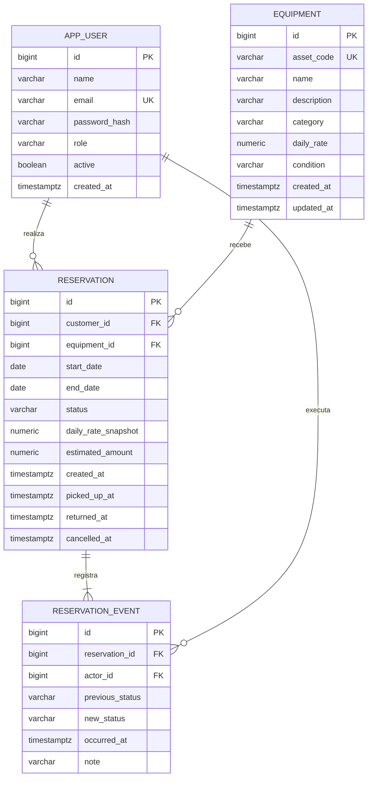
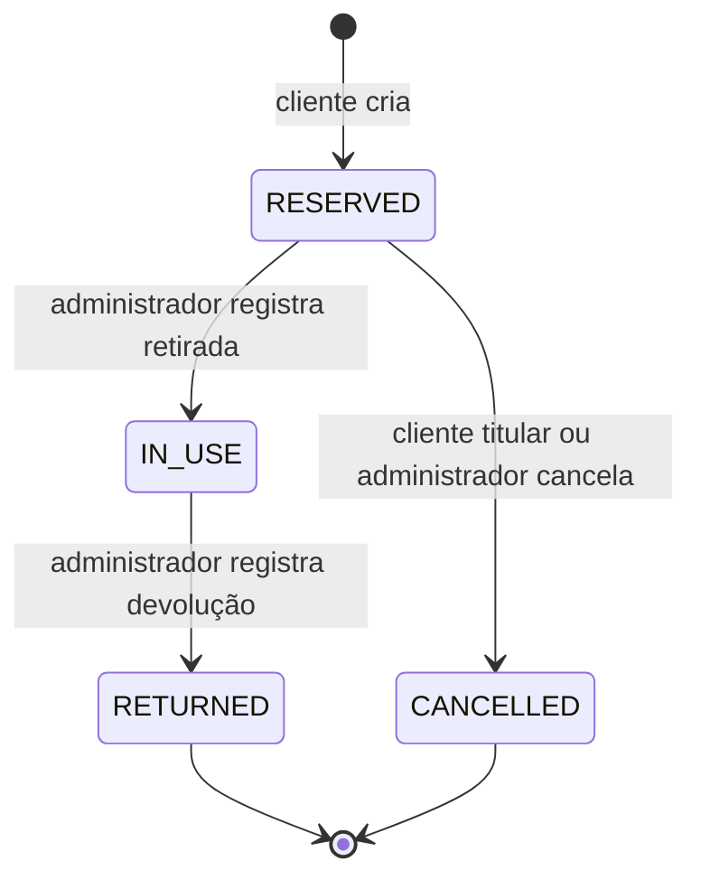

# Planejamento do EquipRent

## 1. Objetivo e limites

Organizar a locação de equipamentos de uma pequena empresa, substituindo controles dispersos por um catálogo de unidades físicas, reservas por período e histórico de retirada e devolução. O projeto deve demonstrar fundamentos de desenvolvimento web, integridade de dados, autorização e testes em entrevistas de estágio e nível júnior.

**Entrega atual:** etapas 0 a 6 implementadas: base, modelo JPA, migração V1, autenticação ADMIN/CLIENTE, clientes, catálogo, disponibilidade, estimativa, criação/cancelamento de reservas, listagens por perfil, retirada/devolução, manutenção ao devolver, atrasos e linha do tempo. Há testes em PostgreSQL, inclusive concorrentes. Execução efetiva em JDK 21 permanece pendente. A próxima etapa é acabamento, revisão visual do fluxo completo e CI.

### Primeira versão

- Autenticação com perfis `ADMIN` e `CLIENTE`.
- Cadastro de clientes e equipamentos: nome, descrição, categoria, código individual e diária.
- Disponibilidade por período, criação e cancelamento de reservas de um único equipamento.
- Estimativa do aluguel com diária histórica, retirada, devolução e identificação de atraso.
- Histórico de reservas e movimentações com autor e instante da operação.
- Manutenção, preservação de registros e desativação em vez de exclusão de históricos.
- Busca, filtros, paginação e interface responsiva em português.

**Fora da primeira versão:** pagamentos, multas automáticas, e-mails, várias empresas, aplicativos móveis, carrinho com vários equipamentos, agendamento de manutenção, prorrogação e reprogramação de reservas. Uma reserva não terá seus dias editados: cancelar e reservar novamente evita reprecificação e transições ambíguas.

## 2. Arquitetura e decisões técnicas

Monólito Spring Boot com Spring MVC e páginas Thymeleaf. Um processo Java e um PostgreSQL. Bootstrap local para o layout, sem build JavaScript obrigatório. Java 21 e Spring Boot 4.1.2, cuja compatibilidade foi confirmada na [documentação oficial](https://docs.spring.io/spring-boot/system-requirements.html) em 27/10/2026.

Organização **por funcionalidade**, mantendo classes pequenas e papéis explícitos. Não criar interfaces de service sem necessidade, controllers genéricos, repositórios base próprios ou camadas que só repassem chamadas.

```text
com.equiprent
  EquipRentApplication
  home/
    HomeController                         # existe
  user/                                    # implementado na etapa 2
    User, UserRole, UserRepository
    UserService, UserController, UserForm, UserSummary
  equipment/                               # catálogo e condição física implementados na etapa 3
    Equipment, EquipmentCondition, EquipmentCategory
    EquipmentRepository, EquipmentService, EquipmentController
    EquipmentForm, EquipmentSummary
  reservation/                             # fluxo de reservas implementado nas etapas 4 a 6
    Reservation, ReservationStatus, ReservationEvent
    ReservationRepository, ReservationEventRepository
    ReservationService, ReservationController, RentalPeriod, AvailabilityRules
    ReservationForm, ReservationEstimate, ReservationConfirmation
    ReservationManagementService, ReservationManagementController
    ReservationFilter, ReservationSummary, ReservationDetails, CancellationForm
    ReservationOperationsService, ReturnForm, ReservationTimelineEntry
  security/                                # implementado na etapa 2
    SecurityConfig, CustomUserDetailsService, CurrentUser
    ActiveUserFilter, AdminBootstrap, AccountController
    ApplicationSecurityConfiguration, NavigationAdvice
  shared/                                  # somente quando necessário
    configuração de Clock e tratamento de erros comuns

resources/templates/{home,user,security,fragments,error}/  # implementadas
resources/templates/{equipment,reservation}/              # implementadas
resources/static/{css,vendor}/
resources/db/migration/V1__create_initial_schema.sql  # implementada
```

Services, controllers e formulários do catálogo e da criação de reservas estão implementados. Disponibilidade é uma consulta paginada do catálogo; seu predicado de bloqueio é compartilhado com a confirmação. O Clock da zona de negócio é usado nos cadastros, períodos e auditoria. Não há classes vazias para operações futuras.

O controller recebe formulários, valida entradas e escolhe a view. O service aplica regras, autorização por proprietário e transações. O repository consulta e persiste. Entidades representam o estado persistente; formulários não recebem campos como papel, proprietário ou preço histórico do navegador. Objetos de saída são introduzidos quando necessários para montar views sem consultas fora do service.

Flyway controla o esquema e Hibernate apenas o valida (`ddl-auto=validate`). `open-in-view=false` torna explícito o carregamento dos dados antes da renderização. Não expor entidades diretamente como contratos de entrada. O cadastro de clientes já usa `jakarta.validation` no formulário e no service.

**Por que isso é explicável em uma entrevista:** a arquitetura acompanha a complexidade de uma empresa pequena; mantém regras testáveis em services, usa transações reais para concorrência e renderiza HTML no servidor sem duplicar a aplicação em duas tecnologias.

## 3. Modelo de dados implementado na etapa 1

IDs `Long` gerados no banco. Nomes de tabelas em inglês, evitando `user` como nome SQL reservado: usar `app_user`. Enums persistidos como texto (`EnumType.STRING`), com restrições SQL coerentes. Datas do aluguel como `LocalDate`/`date`; instantes de auditoria como `Instant`/`timestamptz`.

| Entidade | Campos principais e restrições |
| --- | --- |
| `User` | id, name, email normalizado e único, passwordHash, role (`ADMIN`, `CLIENTE`), active, createdAt. Cliente é um usuário com papel CLIENTE; não duplicar perfil em outra tabela sem necessidade. |
| `Equipment` | id, assetCode único e imutável, name, description, category, dailyRate (`numeric(12,2)` positivo), condition (`OPERATIONAL`, `MAINTENANCE`, `RETIRED`), createdAt, updatedAt. Cada linha é uma unidade física. |
| `Reservation` | id, customerId, equipmentId, startDate, endDate, status, dailyRateSnapshot (`numeric(12,2)`), estimatedAmount (`numeric(14,2)`), createdAt, pickedUpAt opcional, returnedAt opcional, cancelledAt opcional. |
| `ReservationEvent` | id, reservationId, actorId, previousStatus opcional apenas na criação, newStatus, occurredAt, note opcional (motivo obrigatório no cancelamento administrativo). Histórico imutável de transições. |

Categorias iniciais propostas: `NOTEBOOK`, `CAMERA`, `TOOL`, `OTHER`, exibidas em português. Enum basta para o escopo inicial; cadastro dinâmico de categorias pode surgir se houver necessidade real.



Chaves estrangeiras obrigatórias e com `ON DELETE RESTRICT`, sem cascatas JPA. `customerId` deve apontar para um CLIENTE; o service de reserva valida essa regra e obtém o proprietário da sessão. Já existem índices por equipamento/status/período, cliente/data de criação, evento/reserva/instante e autor do evento. Validar planos e ajustar índices conforme as consultas de negócio evoluírem, sem antecipar otimizações.

Restrições de banco: fim >= início, diária e total positivos, valores de enums válidos e timestamps compatíveis com o estado. Preço e total são snapshots imutáveis; alteração do catálogo não reescreve reservas. O código patrimonial permanece estável para identificar o item mesmo se nome ou descrição mudarem. O histórico não pretende guardar cada edição de perfil ou descrição; essa auditoria ampliada é evolução futura.

### Decisões consolidadas na modelagem

| Campo | Limite e comportamento |
| --- | --- |
| Nome de usuário/equipamento | 120 caracteres; obrigatório e não vazio |
| E-mail | 254 caracteres; normalizado com `strip()` e `toLowerCase(Locale.ROOT)`; banco exige forma normalizada e unicidade |
| Hash da senha | 255 caracteres; entidade recebe hash pronto; codificação PBKDF2 e login implementados na etapa 2 |
| Código patrimonial | 50 caracteres; sem espaços nas extremidades, único e sensível a maiúsculas/minúsculas |
| Descrição de equipamento | 2.000 caracteres; obrigatória e não vazia |
| Nota do evento | 1.000 caracteres; opcional |
| Papel, categoria, condição e status | `varchar(20)` com enum Java e `CHECK` no banco |

Construtores JPA protegidos e construtores explícitos para criação; sem setters genéricos. Relações `ManyToOne` usam `LAZY`, sem listas bidirecionais desnecessárias. O chamador informa os instantes; na etapa de negócio eles virão de um `Clock` injetado. Código patrimonial, datas e valores contratados não são atualizáveis pelo mapeamento JPA. Eventos usam `@Immutable` e repository sem método de exclusão; isso não impede alterações via SQL administrativo.

O construtor monetário usa escala 2 com `RoundingMode.UNNECESSARY`, rejeitando frações de centavo antes de o PostgreSQL arredondá-las. Positividade e precisão máxima são protegidas no banco. Formulários e services também validam entradas com mensagens amigáveis, incluindo o total calculado na criação da reserva.

A V1 verifica a coerência de cada par de estados em um evento e dos timestamps de cada reserva. Ela ainda não garante a sequência completa entre eventos, um evento para toda alteração, o perfil do autor, disponibilidade ou ausência de reservas sobrepostas. Os testes de persistência não substituem os futuros testes de service, autorização e concorrência. Os SQLs que simulam alterações nos testes servem apenas para validar o modelo.

## 4. Regras de negócio e premissas

### Período, diárias e dinheiro

Adotar dias civis **inclusivos** na zona `America/Sao_Paulo`: início e fim pertencem ao aluguel. `days = ChronoUnit.DAYS.between(startDate, endDate) + 1`. Uma reserva em 10/11/2026 até 10/11/2026 custa uma diária; até 12/11 custa três. A devolução pode acontecer até o fim do último dia. Reservas contíguas sem conflito começam no dia seguinte ao fim da anterior.

Na criação: início >= hoje, fim >= início e limite implementado de 365 diárias. Usar `Clock` injetável para não depender do relógio do computador nos testes. Limites e mensagens são validados no servidor, mesmo que o HTML também limite os campos. Datas aceitam anos até 9999, compatíveis com o formulário; totais acima de R$ 999.999.999.999,99 são recusados antes da gravação para respeitar `numeric(14,2)`.

Dinheiro em reais com `BigDecimal`, criado a partir de texto, nunca de `double`. A diária aceita no máximo duas casas e valor positivo; rejeitar frações adicionais em vez de arredondar silenciosamente. Copiar a diária do equipamento dentro da transação e calcular `dailyRateSnapshot.multiply(BigDecimal.valueOf(days))`, em escala 2. Exemplo: R$ 49,90 × 3 = R$ 149,70. O total é uma estimativa contratada; devolução antecipada ou tardia não recalcula automaticamente e não gera multa nesta versão.

### Disponibilidade versus condição física

`OPERATIONAL` indica condição física apta ao uso. Não significa livre em todos os períodos. Disponibilidade é uma **consulta** que combina condição física, reservas que bloqueiam o intervalo e pendências de devolução. Não persistir um booleano `available` nem marcar a condição como “reservado”.

Uma reserva `RESERVED` ou `IN_USE` conflita quando `existing.startDate <= requested.endDate && existing.endDate >= requested.startDate`. `CANCELLED` e `RETURNED` não bloqueiam novas reservas. Após devolução antecipada e conferência pelo ADMIN, a unidade pode ser reservada novamente, inclusive no mesmo dia; cada contrato mantém sua própria estimativa de diárias.

Uma unidade `MAINTENANCE` ou `RETIRED` não aceita novas reservas nem retirada. Manutenção não tem previsão de término na primeira versão, portanto bloqueia qualquer período novo. Uma reserva futura não muda automaticamente a condição física.

Se houver aluguel `IN_USE` vencido, bloquear novas reservas de qualquer período até a devolução: não há previsão confiável de liberação. Reservas futuras já existentes continuam registradas e são sinalizadas ao administrador; retirada é impedida enquanto a unidade estiver com outro cliente. Não cancelar compromissos silenciosamente.

Mudança para manutenção não é permitida durante uso; o administrador registra a devolução e pode marcar manutenção na mesma transação. Com reservas futuras, permitir manutenção e destacá-las como afetadas para cancelamento manual com motivo. Aposentadoria (`RETIRED`) exige ausência de reservas `RESERVED`/`IN_USE`. Essas regras precisam usar o mesmo bloqueio transacional da reserva.

### Concorrência: impedir a dupla reserva

Uma consulta prévia na interface não garante que o item continuará disponível. A operação de criação deverá:

1. Abrir uma transação `@Transactional` em isolamento `READ_COMMITTED`.
2. Bloquear primeiro a linha do cliente e revalidar que está ativo; depois buscar `Equipment` por ID com `PESSIMISTIC_WRITE` (`SELECT ... FOR UPDATE`). A desativação já bloqueia o cliente: compartilhar esse bloqueio impedirá que uma reserva nasça durante a desativação. Bloquear o equipamento funciona mesmo quando ainda não existe nenhuma reserva.
3. Depois de adquirir os bloqueios, revalidar condição, período, atraso pendente e sobreposição em uma nova consulta.
4. Ler a diária protegida, inserir reserva e evento de criação na mesma transação e confirmar.

A segunda solicitação para a mesma unidade espera; após a primeira confirmar, enxerga a reserva e recebe uma mensagem de indisponibilidade. Equipamentos diferentes não se bloqueiam mutuamente. Não usar `synchronized`, pois só protegeria uma instância Java. Bloquear apenas reservas existentes também não resolve o caso de conjunto vazio.

Quando uma operação precisar bloquear cliente e equipamento, a ordem será cliente → equipamento → reserva. Desativação bloqueia somente cliente. Alterações de condição/preço e operações que não precisem bloquear cliente começam pelo equipamento e depois bloqueiam/recarregam a reserva, sem adquirir bloqueio de cliente posteriormente. Timeout/deadlock devem resultar em mensagem para tentar novamente, sem sucesso parcial. A tela HTML deve reapresentar o formulário com erro; se houver endpoint JSON no futuro, conflito pode usar HTTP 409.

O protocolo depende de todas as escritas de negócio passarem pelos services; scripts externos não podem criar reservas diretamente. Uma restrição de exclusão PostgreSQL é uma defesa adicional possível, mas não será adicionada sem necessidade na primeira versão. A decisão inicial privilegia bloqueio explícito, fácil de explicar e testar, com documentação desse limite.

### Autorização, manutenção de cadastros e histórico

- CLIENTE consulta, cria e cancela somente suas reservas. O proprietário vem da sessão, nunca de um ID de cliente enviado no formulário. Buscar detalhes por ID **e** proprietário; retornar 404 para uma reserva alheia evita revelar sua existência.
- ADMIN cadastra/edita equipamentos e clientes, controla manutenção, consulta todas as reservas, cancela com motivo e registra retirada/devolução. A primeira versão não permite que CLIENTE escolha seu próprio papel.
- Autenticação por formulário e sessão do Spring Security, senha codificada com `PasswordEncoder`, CSRF habilitado e logout via POST. Nenhuma operação de alteração em GET. Não é necessário JWT para um monólito Thymeleaf.
- Cadastro de clientes inicialmente feito pelo ADMIN. Definir criação segura do primeiro ADMIN na etapa de autenticação, por configuração de bootstrap local, sem senha fixa no repositório.
- Bloquear ações de contas inativas também no service, inclusive sessões já abertas. Desativação de cliente exige resolver reservas pendentes; preservar acesso administrativo ao histórico.
- Sem exclusão física de usuários/equipamentos com reservas. Preferir desativação do usuário e `RETIRED` para equipamento. Não apagar reservas nem eventos.
- Autorização deve existir no servidor; ocultar botões é apenas uma conveniência visual. Evitar colocar dados pessoais, senhas ou formulários completos nos logs.

## 5. Estados da reserva

Enums em inglês e rótulos na interface em português:

| Estado | Rótulo | Transições permitidas |
| --- | --- | --- |
| `RESERVED` | Reservada | `IN_USE` por ADMIN; `CANCELLED` pelo proprietário ou ADMIN |
| `IN_USE` | Em uso | `RETURNED` por ADMIN |
| `RETURNED` | Devolvida | Nenhuma |
| `CANCELLED` | Cancelada | Nenhuma |



Retirada requer dia atual dentro do período contratado, equipamento operacional e nenhuma outra reserva em uso. Não permitir retirada antecipada; uma reserva não retirada até o fim permanece `RESERVED` para regularização/cancelamento manual, sem gerar falso atraso de devolução.

Cancelamento é permitido enquanto `RESERVED`, inclusive após o começo previsto se ainda não houve retirada. `IN_USE` não pode ser cancelada. Repetir retirada/devolução/cancelamento de um registro já finalizado deve informar estado inválido sem criar eventos duplicados. Cada transição e seu evento são atômicos.

**Atraso não é um estado persistido.** Enquanto em uso, está atrasada se `LocalDate.now(clock) > endDate`. Depois da devolução, comparar a data de `returnedAt` na zona de negócio com `endDate` preserva a indicação histórica. Não usar job só para mudar status; a condição pode ser calculada na consulta. Testar a fronteira entre 23:59 do último dia e 00:00 do próximo.

## 6. Etapas de implementação

Cada etapa termina com código, testes e README atualizados. Os critérios abaixo são gates: não marcar concluída só porque a tela aparece. A sequência evita implementar operações de negócio antes de haver modelagem e autorização.

### Etapa 0 — Base inicial

- [x] Inspecionar pasta e instruções existentes.
- [x] Fixar Java, Spring Boot e Maven Wrapper.
- [x] Criar aplicação e página inicial em português.
- [x] Configurar PostgreSQL, Compose, volume e variáveis de ambiente.
- [x] Preparar Flyway sem entidades nem migrações de domínio.
- [x] Criar teste MVC e documentação de uso e planejamento.
- [x] Compilar, executar teste e empacotar pelo Wrapper.
- [x] Validar inicialização completa contra PostgreSQL (confirmada pelo usuário e pelos testes da etapa 1).
- [ ] Validar execução em JDK 21.

**Conclusão:** build, teste MVC e inicialização completa com PostgreSQL aprovados. Docker agora está disponível. A máquina consultada continua usando JDK 25 com compilação `release 21`; execução efetiva em JDK 21 permanece pendente.

**Testes:** HTTP 200, template real resolvido, idioma, conteúdo de apresentação e URLs CSS. Na etapa 1, a resposta HTTP também foi validada com servidor real e PostgreSQL.

**Aprendizado:** ciclo Maven, auto-configuração, MVC, configuração externa e responsabilidades do Flyway.

### Etapa 1 — Modelo e migração (depende da 0)

- [x] Revisar premissas e definir tamanhos máximos dos campos.
- [x] Criar entidades e enums sem telas de negócio.
- [x] Escrever `V1__create_initial_schema.sql` com chaves, checks e índices iniciais.
- [x] Criar repositories necessários e mapeamentos explícitos.
- [x] Adicionar testes Spring Data JPA com PostgreSQL Testcontainers e suporte Flyway.
- [x] Verificar banco vazio e segunda inicialização sem mudanças indevidas.

**Conclusão:** migração sobe do zero, Hibernate valida o esquema e relações persistem sem apagar histórico. Nenhum `ddl-auto=update` ou migração já aplicada editada.

**Testes:** unicidade de e-mail normalizado e código patrimonial; FK obrigatória; rejeição de período invertido/preços inválidos; valores `BigDecimal` preservados e rollback. Não substituir PostgreSQL por H2 nos testes de integração.

**Aprendizado:** cardinalidade, restrições, migrações e precisão monetária.

**Resultado em 27/10/2026:** `clean verify` aprovado com 2 testes unitário/MVC e 75 casos de integração, zero falhas/erros/ignorados. O teste de integração sobe a aplicação completa, valida o esquema com Hibernate, consulta os repositories e reinicia o contexto sobre o mesmo banco. Usa PostgreSQL 17 temporário, sem ler o `.env` ou modificar o volume de desenvolvimento.

### Etapa 2 — Autenticação, perfis e clientes (depende da 1)

- [x] Adicionar Spring Security, seu suporte de teste e Bean Validation.
- [x] Implementar login/logout com sessão, CSRF e mensagens em português.
- [x] Criar primeiro ADMIN por configuração local sem segredo versionado.
- [x] Criar formulário de cadastro de cliente pelo ADMIN, validação e hash de senha.
- [x] Proteger rotas por papel e criar testes da matriz de acesso.
- [x] Implementar desativação com validação de pendências.

**Conclusão:** login válido funciona; senha incorreta falha; banco só guarda hash; CLIENTE não administra e conta inativa não opera. A criação de administrador não depende de senha padrão pública.

**Testes:** anônimo redirecionado ao login, ADMIN autorizado, CLIENTE recebe 403 nas ações administrativas, CSRF ausente rejeitado, e-mail duplicado rejeitado e papel enviado pelo navegador ignorado/rejeitado. Testar senha e usuário inativo.

**Aprendizado:** diferença entre autenticação, papel e propriedade dos dados; proteção de formulários e armazenamento de senhas.

**Decisões implementadas:** login por e-mail normalizado e sessão; CSRF habilitado; logout/desativação por POST. `CurrentUser` revalida papel e atividade no banco dentro dos services. `ActiveUserFilter` invalida a sessão de conta desativada na próxima requisição. Os formulários só recebem nome, e-mail e senha; clientes são sempre criados com papel CLIENTE. Listagem de 20 clientes por página, com `UserSummary` sem hash.

Senhas de 12 a 64 caracteres usam PBKDF2 com salt aleatório e prefixo versionado `{pbkdf2@SpringSecurity_v5_8}`. Não há senha padrão, cadastro público, recuperação/troca de senha ou reativação nesta entrega. O bootstrap opcional recebe `BOOTSTRAP_ADMIN_*`, cria apenas o primeiro administrador e não promove clientes nem troca senhas existentes. Sua transação usa bloqueio de tabela para serializar inicializações simultâneas; desativação usa bloqueio de linha e impede clientes com reservas pendentes.

**Resultado em 27/10/2026:** `verify` aprovado com 109 testes (2 unitário/MVC, 75 de persistência e 32 de segurança), sem falhas/erros/ignorados. A V1 não foi alterada; não há nova migração nesta etapa. O banco de desenvolvimento não foi usado nos testes. Ver instruções de bootstrap e roteiro manual no README.

### Etapa 3 — Catálogo e condição física (depende da 2)

- [x] Criar formulário e service de equipamento com código único, categoria e diária.
- [x] Criar listagem, detalhes e edição para ADMIN.
- [x] Exibir catálogo consultável por CLIENTE.
- [x] Implementar manutenção, retorno a operacional e aposentadoria.
- [x] Adicionar busca por nome/código, filtro por categoria/condição e paginação.

**Conclusão:** ADMIN mantém unidades individuais; cliente consulta; dados inválidos não persistem. Paginação padrão de 20, limitada entre 1 e 100, ordenação estável por ID como desempate e campos de ordenação permitidos explicitamente.

**Testes:** códigos duplicados, diária negativa/zero/mais de duas casas, campos vazios, permissões, filtros combinados, página vazia e limite de paginação. Testar manutenção e preservação do histórico.

**Aprendizado:** validação em camadas, consultas paginadas e distinção entre formulário e entidade.

**Decisões implementadas:** código patrimonial imutável, único e sensível a maiúsculas/minúsculas; busca parcial sem distinguir caixa, com curingas do SQL tratados literalmente. Rótulos em português e valores em reais. Cadastro sempre operacional, independente de campos extras enviados pelo navegador. Alterações de dados/preço e condição bloqueiam a linha do equipamento; preço histórico das reservas permanece intacto. Services revalidam papel e atividade no banco.

Manutenção é proibida com `IN_USE`; com `RESERVED`, as reservas permanecem e aparecem paginadas apenas para ADMIN. Aposentadoria exige ausência de ambas as pendências, é definitiva e preserva histórico. CLIENTE não vê aposentados, inclusive por ID direto (404); ADMIN pode consultá-los e editar seus dados descritivos. Não há exclusão física. O tratamento de falha transitória nesta etapa apresenta página 503 para nova tentativa. Reservar/cancelar e a devolução com manutenção na mesma transação continuam nas etapas seguintes.

**Resultado em 27/10/2026:** `clean verify` aprovado com 149 testes (2 unitário/MVC, 75 de persistência, 32 de segurança e 40 do catálogo), sem falhas/erros/ignorados. Inclui templates reais e concorrência: aposentadoria espera pelo bloqueio da unidade e revalida uma reserva confirmada pela outra transação. PostgreSQL 17 descartável, sem alterar V1 ou banco de desenvolvimento. JDK 21 efetivo e revisão visual manual ainda pendentes; execução realizada com JDK 25 e `release 21`.

### Etapa 4 — Disponibilidade, estimativa e criação (depende da 3)

- [x] Usar o `Clock` já disponível e implementar o cálculo de diárias inclusivas.
- [x] Criar busca de equipamentos disponíveis por período.
- [x] Implementar estimativa no servidor e snapshot de diária na reserva.
- [x] Implementar transação com bloqueio pessimista do equipamento.
- [x] Registrar criação e evento atomicamente, associando o cliente autenticado.
- [x] Exibir confirmação e mensagem amigável em conflito.

**Conclusão:** duas tentativas simultâneas sobrepostas para a mesma unidade geram exatamente uma reserva; a outra falha por indisponibilidade. A estimativa e o proprietário não podem ser adulterados pelo formulário. A consulta de disponibilidade e a criação usam as mesmas regras.

**Testes obrigatórios:**

| Cenário | Resultado esperado |
| --- | --- |
| Mesmas datas, intervalo contido e intervalo que contém outro | Conflito |
| Fim de uma reserva igual ao início de outra | Conflito: dias inclusivos |
| Começo no dia seguinte ao término | Permitido |
| Mesmas datas em equipamentos diferentes | Permitido |
| Equipamento em manutenção/aposentado ou aluguel vencido em uso | Bloqueado |
| Período passado, invertido ou maior que o limite | Rejeitado |
| Um dia / três dias / mudança de mês e ano / ano bissexto | Quantidade correta |
| R$ 49,90 × 3; diária editada depois da reserva | R$ 149,70; snapshot preservado |
| Falha ao inserir evento | Reserva também revertida |
| Dois clientes concorrentes sobre o mesmo equipamento | Uma confirmação e um conflito |

O teste concorrente usa duas threads e duas transações reais, conexões distintas e PostgreSQL Testcontainers. Preparar os dados com commit antes das threads, coordenar o início com barreira/latch e limitar esperas com timeout. Não usar um único teste `@Transactional` que esconda commits; não validar concorrência com mocks. Conferir reservas **e** eventos após ambas as operações. Testar também reservas não conflitantes simultâneas, criação concorrente com entrada em manutenção e criação concorrente com desativação do cliente.

**Aprendizado:** condições de corrida, isolamento, bloqueios, atomicidade e cálculos determinísticos.

**Decisões implementadas:** datas opcionais em conjunto na busca do catálogo e obrigatórias na reserva; a mesma expressão de reservas bloqueantes é usada nas duas consultas. Estimativa GET não grava nem segura a unidade. Confirmação POST usa o preço vigente sob bloqueio e gera reserva/evento na mesma transação `READ_COMMITTED`; o usuário é recarregado após o bloqueio para enxergar desativação concorrente. Formulário aceita somente equipamento e datas. A URL de confirmação pertence ao CLIENTE titular; outro cliente recebe 404. ADMIN consulta disponibilidade, mas não cria reservas em nome de clientes nesta versão.

Valores da estimativa podem mudar antes da confirmação; a interface informa a revalidação. Depois da criação, o snapshot não muda. Conflitos e timeout de bloqueio reapresentam as datas com mensagem amigável. O teste de timeout configura limite menor exclusivamente no PostgreSQL descartável. A V1 permanece intacta. Listagem de reservas e cancelamento não foram antecipados.

**Resultado em 27/10/2026:** `clean verify` aprovado com 190 testes (14 unitário/MVC, 75 de persistência, 32 de segurança, 40 de catálogo e 29 de reservas), sem falhas/erros/ignorados. Os cenários obrigatórios acima foram cobertos, incluindo transações concorrentes e rollback de reserva/evento. Testes com PostgreSQL 17 descartável e relógio controlado, sem tocar no banco de desenvolvimento. Execução em JDK 25 com `release 21`; JDK 21 efetivo e revisão visual manual seguem pendentes.

### Etapa 5 — Minhas reservas e cancelamento (depende da 4)

- [x] Criar listagem e detalhes do cliente com busca/filtros e paginação.
- [x] Criar visão administrativa de todas as reservas.
- [x] Implementar cancelamento por POST, motivo administrativo e evento.
- [x] Impedir alteração de proprietário, período e snapshot após criação.
- [x] Testar tentativa de acesso por IDs de outro cliente.

**Conclusão:** cliente A não lê nem cancela reservas de B, mesmo alterando a URL ou o corpo. Cancelamento libera o período e preserva os dados e eventos.

**Testes:** matriz anônimo/CLIENTE titular/CLIENTE alheio/ADMIN em listagem, detalhes e cancelamento; CSRF; cancelamento duplicado; cancelamento de registro em uso; filtros sem vazamento de dados; duas tentativas de cancelamento produzem um único evento.

**Aprendizado:** autorização por registro, prevenção de acesso indevido por ID e histórico.

**Decisões implementadas:** rotas CLIENTE em `/reservas` e ADMIN em `/admin/reservas`. Busca por equipamento, status e período para ambos; busca por nome/e-mail do cliente somente na área administrativa. Datas opcionais e independentes filtram sobreposição inclusiva, inclusive histórica. Paginação padrão 20, máximo 100 e ID decrescente como desempate. Consulta com relações carregadas evita N+1; DTOs não incluem hashes.

Cancelamento aceita somente motivo (até 1.000 caracteres), obrigatório para ADMIN e opcional para CLIENTE. Services revalidam papel/atividade e propriedade. Equipamento é bloqueado antes da reserva, cujo estado é recarregado após a espera; cancelamento/evento são atômicos. Somente `RESERVED` pode ser cancelada, mesmo após o período previsto se não houve retirada. Repetição não cria evento. Detalhes mostram autor, motivo e horário em São Paulo; a confirmação antiga passa a refletir o estado atual. Histórico continua acessível ao ADMIN para clientes inativos/equipamentos aposentados. Nenhuma alteração na V1.

**Resultado em 27/10/2026:** `clean verify` aprovado com 226 testes (14 unitário/MVC e 212 de integração), sem falhas/erros/ignorados. Os 36 novos testes cobrem autorização, filtros, preservação de valores, motivos, cancelamentos concorrentes, corrida com nova reserva, rollback de evento e timeout. Lista de 20 reservas com equipamentos distintos validada com até três comandos SQL. PostgreSQL 17 descartável, sem usar banco de desenvolvimento. JDK 25 com `release 21`; JDK 21 efetivo e revisão visual manual ainda pendentes.

### Etapa 6 — Retirada, devolução e atrasos (depende da 5)

- [x] Implementar transições apenas por ADMIN e validar estado atual sob bloqueio.
- [x] Registrar instantes e eventos de retirada/devolução.
- [x] Permitir condição de manutenção ao devolver, na mesma transação.
- [x] Exibir atrasos atuais, devoluções tardias e reservas futuras afetadas.
- [x] Exibir linha do tempo completa, integrada aos filtros de status/cliente/equipamento/período já implementados na etapa 5.

**Conclusão:** somente a máquina de estados definida é aceita. Nunca existem duas retiradas abertas para a mesma unidade. Atrasos usam a zona de negócio e continuam identificáveis após a devolução. Não há multa nem alteração automática do preço histórico.

**Testes:** cada transição válida e inválida; CLIENTE não retira/devolve; retirada antecipada ou após prazo rejeitada; cancelamento contra retirada concorrente; retirada/devolução duplicada; manutenção bloqueia retirada; falha de evento reverte status; limites de meia-noite com Clock fixo; devolução antecipada, pontual e tardia.

**Aprendizado:** máquinas de estados, consistência transacional, tempo de negócio e auditoria.

**Decisões implementadas:** POST `/admin/reservas/{id}/retirar` e `/devolver`, com CSRF e papel/atividade revalidados no service. Retirada apenas de `RESERVED`, dentro do período inclusivo, com unidade operacional e sem outro `IN_USE`. Devolução apenas de `IN_USE`; formulário aceita somente opção de manutenção. Bloqueio equipamento → reserva, recarga após espera, evento/instantes/condição física atômicos. Repetições e transições inválidas não criam eventos. Preço histórico não muda em devolução antecipada ou tardia.

Atraso atual calculado por data civil de São Paulo; devolução tardia usa a data local do instante registrado, preservando a indicação histórica. Listas ganham filtro de atrasos em aberto sem perder escopo do cliente ou paginação. Detalhes mostram linha do tempo com autores carregados junto dos eventos e desempate por ID. Evento de devolução guarda a decisão operacional/manutenção. Equipamentos em manutenção ou com `IN_USE` atrasado exibem ao ADMIN as reservas `RESERVED` com fim a partir de hoje, paginadas; compromissos permanecem até cancelamento manual. V1 intacta.

**Resultado em 27/10/2026:** `clean verify` aprovado com 267 testes (14 unitário/MVC e 253 de integração), sem falhas/erros/ignorados. Os 41 novos testes cobrem o fluxo completo, limites de meia-noite/UTC, autorização, atrasos, manutenção, reservas afetadas, rollback e concorrência entre as operações. Detalhes com três eventos validados em até cinco comandos SQL. PostgreSQL 17 descartável; banco de desenvolvimento preservado. Execução em JDK 25 com `release 21`; JDK 21 efetivo e revisão visual manual seguem pendentes para a etapa 7.

### Etapa 7 — Acabamento e fluxo completo (depende da 6)

- [ ] Padronizar navegação, layout, formulários e mensagens de erro.
- [ ] Revisar telas vazias, filtros persistidos na paginação e confirmações.
- [ ] Revisar valores em reais, datas brasileiras, labels, foco e navegação por teclado.
- [ ] Testar desktop e largura de 360 px sem rolagem horizontal indevida.
- [ ] Executar fluxo completo com contas separadas de ADMIN e CLIENTE.
- [ ] Configurar CI com JDK 21, testes unitários/MVC e integração PostgreSQL.

**Conclusão:** fluxo cadastro → consulta → reserva → retirada → devolução funciona e o histórico é coerente. Suite completa passa em JDK 21; nenhum endpoint administrativo depende só de botões ocultos.

**Testes:** roteiro ponta a ponta, erros 403/404, validações preservando dados digitados, ausência de recursos externos obrigatórios e revisão de consultas para evitar N+1 nas listagens.

**Aprendizado:** integração, experiência do usuário, acessibilidade básica e automação de qualidade.

### Etapa 8 — Preparação do portfólio (depende da 7)

- [ ] Criar dados fictícios opcionais em perfil de demonstração, sem dados pessoais reais.
- [ ] Produzir capturas de catálogo, reserva, administração e histórico em desktop/mobile.
- [ ] Gravar demonstração curta do fluxo e de um conflito de reservas.
- [ ] Atualizar README com funcionalidades reais, imagens, arquitetura e limitações.
- [ ] Documentar como executar a suite e reproduzir o teste concorrente.
- [ ] Preparar explicação de 3–5 minutos sobre escolhas, tradeoffs e melhorias futuras.

**Conclusão:** outra pessoa consegue executar seguindo apenas o README e reproduzir a demonstração. A documentação diferencia decisões implementadas de evoluções futuras. Qualquer hospedagem/publicação exige uma tarefa posterior específica.

**Testes:** instalação limpa, migrações do zero, dados de demo repetíveis, comandos conferidos e ausência de segredos em arquivos/imagens. Executar toda a suite antes de registrar a demonstração.

**Aprendizado:** comunicação técnica, demonstração de evidências e apresentação do projeto em entrevistas.

## 7. Decisões ainda a revisar

As seguintes propostas permitem avançar sem bloquear a base, mas devem ser revistas antes da respectiva etapa:

| Decisão | Premissa inicial | Momento da revisão |
| --- | --- | --- |
| Horário comercial e tolerância | Sem janela de horas; prazo por dia civil | Antes de uso real |

Não introduzir pagamento, multas, mensagens assíncronas ou múltiplas empresas para resolver essas pendências. Registrar qualquer mudança de regra junto dos exemplos e testes correspondentes.
