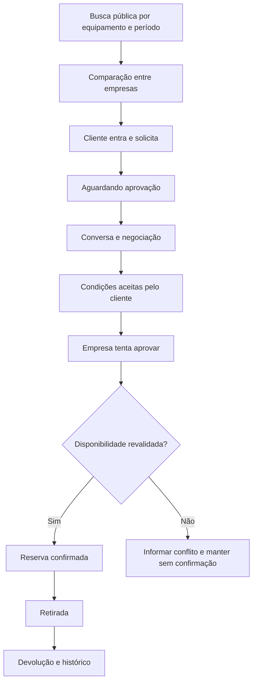

# Planejamento do EquipRent

## 1. Objetivo e situação atual

Construir um marketplace de aluguel de equipamentos: o cliente pesquisa equipamento e período, compara empresas e diárias, solicita uma reserva e negocia com a empresa pelo site. A empresa aprova a reserva e acompanha retirada, devolução e histórico.

A base de locação, a M1 (empresas e permissões) e a M2 (busca pública e cadastro pessoal) estão implementadas. O cliente pesquisa sem login por equipamento, categoria, período e cidade/UF, compara empresas e pode criar sua conta. A confirmação de reserva ainda é direta pelo cliente. Solicitação sujeita a aprovação, proposta negociada e chat serão implementados nas etapas M3 e M4.

O ambiente de execução usa apenas a configuração normal com `.env` e `compose.yaml`. O cadastro inicial de administrador é explícito, e novas empresas são provisionadas por `scripts/Register-Company.ps1`. Não há contas, equipamentos ou reservas carregados automaticamente.

Antes de cada nova implementação, apresentar mudanças, partes afetadas e verificações; aguardar aprovação do usuário. Commit, push e publicação dependem de autorização própria. A hospedagem permanece adiada.

## 2. Base técnica e regras implementadas

### Arquitetura e dados

Monólito Java 21/Spring Boot com MVC, Thymeleaf e Bootstrap local, usando PostgreSQL 17. Organização por funcionalidade: `company`, `user`, `equipment`, `reservation`, `security` e `home`. Controllers validam formulários; services revalidam permissões e coordenam transações; JPA e JDBC acessam o banco.

Flyway aplica V1, V2 e V3. Não editar migrações já aplicadas; usar novas versões para evoluir o esquema. Hibernate usa `ddl-auto=validate` e `open-in-view=false`. A V2 associa registros anteriores à Empresa inicial; a V3 acrescenta cidade/UF opcionais. Contas, senhas, IDs, datas, valores e eventos são preservados.

| Estrutura | Responsabilidade |
| --- | --- |
| `app_user` | Conta pessoal com e-mail normalizado único, hash de senha, papel e atividade. |
| `company` | Empresa proprietária das unidades, com nome, código estável, atividade e cidade/UF opcionais. |
| `company_membership` | Vínculo administrativo ativo: uma empresa por conta e vários administradores por empresa. |
| `company_customer` | Relação comercial e bloqueio de novos aluguéis por empresa, preservando a conta global do cliente. |
| `equipment` | Unidade física de uma empresa, com código imutável e único dentro dela, categoria, diária e condição. |
| `reservation` | Cliente, unidade, empresa, período, estado e valores contratados. Chave estrangeira composta garante coerência entre unidade e empresa. |
| `reservation_event` | Autor, instante, transição e motivo; histórico preservado. |

### Autorização

- ADMIN precisa de conta, vínculo e empresa ativos; administra somente os dados de sua empresa, inclusive consultas, contagens e detalhes por ID.
- CLIENTE consulta e altera somente suas reservas e pode alugar em várias empresas. O servidor obtém o proprietário da sessão e a empresa do equipamento.
- Bloquear cliente impede novos aluguéis somente naquela empresa e exige resolver as reservas pendentes nela. O login e o histórico permanecem acessíveis.
- Papel, empresa e autoria enviados pelo navegador não concedem acesso. Rotas privadas alheias retornam 404; ações administrativas exigem autorização no servidor.
- Login usa sessão, PBKDF2, CSRF e logout via POST. Senhas têm 12 a 64 caracteres. Bootstrap e provisionamento não promovem clientes nem redefinem senhas existentes.
- `/catalogo` publica somente os dados comerciais de empresas ativas e equipamentos operacionais. `/cadastro` cria somente CLIENTE; vinculação comercial ocorre na reserva. Login/cadastro preservam a pesquisa e as datas por destinos construídos no servidor.
- Cidade/UF são editáveis pelo administrador da própria empresa em `/admin/empresa`. A alteração bloqueia a empresa para serializar atualizações e revalida conta/vínculo ativos.

### Períodos, valores e disponibilidade

- Datas inclusivas em `America/Sao_Paulo`: um aluguel com início e fim no mesmo dia custa uma diária. `Clock` injetável controla a data de negócio.
- Novo aluguel exige início a partir de hoje, fim igual/posterior ao início e no máximo 365 diárias. Anos até 9999; total limitado à precisão `numeric(14,2)`.
- Valores em reais com `BigDecimal`, positivos e com no máximo duas casas decimais. A diária e o total são copiados na confirmação e não mudam com edições posteriores do catálogo, retirada ou devolução.
- `RESERVED` e `IN_USE` bloqueiam intervalos sobrepostos; os dois extremos contam. Uso vencido bloqueia qualquer novo período até a devolução.
- Manutenção e aposentadoria impedem novos aluguéis. Manutenção durante uso requer devolução; reservas futuras afetadas são preservadas e destacadas. Aposentadoria exige resolver reservas pendentes.
- Disponibilidade é calculada por consulta. Não persistir um booleano indicando se a unidade está livre.

### Estados e transações

| Estado atual | Transições |
| --- | --- |
| `RESERVED` | Retirada pela empresa → `IN_USE`; cancelamento pelo titular/empresa → `CANCELLED`. |
| `IN_USE` | Devolução pela empresa → `RETURNED`. |
| `RETURNED` / `CANCELLED` | Estados finais, sem exclusão do histórico. |

Retirada ocorre dentro do período contratado, com unidade operacional e sem outro uso aberto. Devolução pode colocar o equipamento em manutenção na mesma transação. Cancelamento administrativo exige motivo. Atraso é calculado pelo relógio de negócio, sem estado persistido nem multa automática.

Confirmação de reserva usa bloqueio compartilhado da empresa, seguido por cliente → equipamento. Operações administrativas revalidam empresa/vínculo/conta e seguem os bloqueios de cliente quando necessário, equipamento → reserva. Depois de esperar, o service recarrega e revalida os registros. Estado e evento são atômicos. Escritas externas precisam respeitar o mesmo protocolo; não há garantia de disponibilidade para SQL administrativo arbitrário.

A suíte de testes usa PostgreSQL descartável e cobre migrações, autorização, preços, períodos, concorrência, rollback e limites de consultas. A integração contínua executa `clean verify` em JDK 21. Consulte [validações](docs/VALIDACOES.md).

## 3. Marketplace — fluxo e modelo planejados

**Situação:** fluxo aprovado em 01/11/2026. M1 implementa empresas e permissões; M2 implementa busca pública, cidade/UF, cadastro pessoal e continuidade após login. Novos estados, propostas e chat continuam planejados. Company é uma entidade JPA; os vínculos administrativos e comerciais são tabelas acessadas por JDBC. Nomes de entidades e estados das etapas seguintes ainda são propostas.

### 3.1. Jornada do cliente e da empresa

1. Visitante pesquisa equipamento e período sem precisar entrar na conta. O catálogo mostra empresa, equipamento, diária e total estimado para os dias inclusivos, com filtros opcionais por cidade/UF da empresa, aprovados e implementados em M2.
2. Cliente entra na própria conta e envia uma solicitação para uma unidade física e datas específicas. A tela deixa explícito que o envio ainda não garante o aluguel.
3. Solicitação fica como **Aguardando aprovação**. Cliente e administradores autorizados daquela empresa podem consultar os detalhes e conversar no chat vinculado a ela.
4. Empresa e cliente negociam. Uma proposta estruturada registra diária, total e condições combinadas. Se o preço ou as condições mudarem, o cliente deve aceitar a versão correspondente antes da confirmação; uma mensagem livre no chat não substitui esse aceite registrado.
5. Administrador da empresa aprova. O servidor revalida autorização, atividade das contas/empresa, período, equipamento, disponibilidade e proposta aceita. Somente após a transação terminar a interface informa **Reserva confirmada**.
6. Empresa registra retirada e devolução. Cliente acompanha a própria reserva, os termos aceitos e o histórico. Recusa e cancelamento mantêm os registros e a conversa.

### 3.2. Empresas, contas e isolamento dos dados

| Participante | Acesso planejado |
| --- | --- |
| Visitante | Consultar catálogo público e disponibilidade; não acessar reservas, conversas ou dados pessoais de clientes. |
| Cliente | Usar uma conta pessoal para solicitar equipamentos de diferentes empresas; consultar, negociar e cancelar somente as próprias solicitações/reservas, conforme o estado. |
| Administrador de empresa | Usar uma conta individual vinculada à empresa; administrar somente seus equipamentos, solicitações, conversas e operações de retirada/devolução. |
| Operação da plataforma | Necessidade, permissões e forma de cadastrar empresas ainda a definir; não pressupor acesso global a conversas nem disponibilizar um painel adicional neste ciclo. |

O papel administrativo passa a ser associado a um vínculo com uma empresa, em vez de conceder acesso a todos os dados do sistema. Cada administrador terá login próprio para identificar a autoria das ações. Uma empresa não poderá editar a senha nem desativar globalmente a conta de um cliente que também aluga em outras empresas.

O escopo de empresa deve ser validado no servidor em cada consulta e alteração, inclusive detalhes por ID, pesquisas, paginação, contagens e mensagens. Não confiar em `companyId`, autor, perfil ou proprietário recebidos do navegador. Para dados privados de outra empresa/cliente, manter a abordagem de não revelar sua existência. Catálogo público usará uma saída própria, sem dados privados de administração ou clientes.

### 3.3. Modelo conceitual proposto

| Conceito | Responsabilidade e invariantes |
| --- | --- |
| `Company` | Identificar a empresa dona dos equipamentos, seus dados públicos e sua situação de atividade. Campos de cadastro e política de aprovação ainda serão detalhados. |
| `CompanyMembership` | Vincular uma conta individual à empresa e definir permissão/atividade nesse vínculo. A escolha de empresa na interface nunca concede acesso por si só. |
| `Equipment` | Pertencer a uma empresa. Proposta: código patrimonial único por empresa, permitindo que duas empresas tenham `NB-001`; cada equipamento continua sendo uma unidade física. Não transferir unidades com histórico entre empresas neste ciclo. |
| `Reservation` | Reutilizar o registro atual, adicionando a fase de solicitação. Guardar cliente, empresa, equipamento, período e estado coerentes entre si. A empresa deve ser derivada do equipamento e permanecer estável. |
| `ReservationOffer` | Registrar versões de preço/condições e o aceite do cliente. Preservar a estimativa inicial e, na aprovação, fixar a proposta aceita como valor contratado imutável. |
| `ReservationEvent` | Manter autor e instante das transições, incluindo solicitação, aprovação e recusa. Negociação/aceite também precisam de registro próprio, sem inventar mudanças de status para representar mensagens. |
| `ChatMessage` | Vincular cada mensagem a uma solicitação/reserva e ao autor autenticado, com data/hora e ordem estável. A empresa da conversa é sempre a da solicitação. |

Manter o monólito Spring Boot, Thymeleaf e PostgreSQL como base. Introduzir módulos de empresa e conversa conforme a implementação exigir, sem criar microserviços ou trocar o frontend para atender este fluxo. A implementação do chat e seus limites serão escolhidos na etapa M4.

Datas continuam inclusivas em `America/Sao_Paulo`, com `Clock` injetável, limite de 365 diárias e dinheiro em reais com `BigDecimal`. Proposta inicial de negociação: uma diária acordada positiva, total calculado pelo servidor e condições textuais; descontos, taxas ou caução separados exigiriam nova definição. Mudar o preço do catálogo não altera uma proposta já aceita nem um contrato confirmado.

### 3.4. Estados, disponibilidade e aprovação

| Estado proposto | Rótulo | Transições previstas |
| --- | --- | --- |
| `REQUESTED` | Aguardando aprovação | `RESERVED` pela empresa após as revalidações; `REJECTED` pela empresa com motivo; `CANCELLED` pelo cliente titular. |
| `RESERVED` | Reserva confirmada | `IN_USE` pela empresa na retirada; `CANCELLED` pelo cliente ou pela empresa conforme a regra de cancelamento. |
| `IN_USE` | Em uso | `RETURNED` pela empresa. |
| `REJECTED` | Solicitação recusada | Nenhuma; uma nova tentativa gera outra solicitação. |
| `CANCELLED` | Cancelada | Nenhuma. |
| `RETURNED` | Devolvida | Nenhuma. |

Negociação e espera pelo aceite acontecem dentro de `REQUESTED`; o estado da proposta indica se falta concordância do cliente. O cliente aceita as condições, mas a decisão de confirmar continua sendo da empresa. Repetir uma ação não pode gerar duas confirmações ou eventos duplicados.

- **Pendências não bloqueiam:** várias solicitações podem existir para a mesma unidade e datas. Busca, chat e aceite de proposta não seguram o equipamento.
- **Confirmação bloqueia:** `RESERVED` e `IN_USE` continuam bloqueando períodos sobrepostos. Uso vencido, manutenção e aposentadoria mantêm as restrições atuais.
- **Conflito posterior é esperado:** a empresa pode receber solicitações enquanto o item estava disponível e encontrar um conflito ao aprovar. Informar o conflito sem confirmar nem apagar a solicitação. As demais pendências ficam sinalizadas, sem recusa automática neste primeiro fluxo.
- **Revalidação na aprovação:** não aprovar período cujo início já passou, conta/empresa sem permissão ou atividade, unidade indisponível ou proposta sem aceite válido. Prazo de expiração automática de pedidos será decidido separadamente.
- **Preço precisa de aceite:** o envio da solicitação registra concordância com a estimativa/condições apresentadas naquela versão. Qualquer contraproposta da empresa invalida o aceite anterior para fins de aprovação até o cliente aceitar a nova versão. Campos ocultos enviados pelo navegador não são prova de aceite ou preço.
- **Confirmação atômica:** travar os registros necessários, recarregar seu estado, conferir a versão aceita e a disponibilidade, gravar `RESERVED`, valores contratados e evento na mesma transação. Falha em qualquer parte reverte toda a confirmação.

O bloqueio do equipamento continua sendo o ponto de serialização de aprovações conflitantes, inclusive entre instâncias da aplicação. Definir uma ordem única para os bloqueios adicionais de empresa/vínculo/cliente/solicitação ao implementar M3, preservando a ordem já definida em M1; preço, condições, aceite e cancelamento concorrentes não podem escapar da revalidação. Compartilhar o predicado de disponibilidade entre catálogo e aprovação, agora sem contar `REQUESTED` como reserva bloqueante.

O desfecho obrigatório para duas aprovações concorrentes sobrepostas é **uma confirmação e um conflito**, com somente um período bloqueado e eventos coerentes. As duas solicitações e seus históricos permanecem registrados.

### 3.5. Conversa e negociação

Haverá uma conversa por solicitação, acessível somente ao cliente titular e aos administradores com vínculo ativo na empresa correspondente. Pessoas de outra empresa, outros clientes e visitantes não poderão ler nem enviar mensagens, mesmo conhecendo o ID.

Proposta inicial para M4: mensagens de texto, histórico paginado, indicação do autor/horário e atualização periódica da conversa; envio via POST com CSRF, limites de tamanho/frequência e texto escapado na exibição. Anexos, chamadas e notificações externas ficam para outro ciclo. Essas escolhas serão apresentadas antes da implementação.

Salvar mensagens não confirma reservas nem altera datas/preços automaticamente. Ações de proposta, aceite e aprovação continuam estruturadas e autorizadas no servidor. Não permitir edição/exclusão de mensagens neste primeiro ciclo; conservar a conversa para consulta após recusa, cancelamento ou devolução. O prazo para permitir novos envios após esses estados ainda precisa ser definido.

### 3.6. Preservação da base e migração

- Adicionar migrações Flyway novas; não reescrever a V1 já aplicada nem apagar volumes para acomodar o marketplace.
- Vincular registros existentes a uma empresa inicial explicitamente definida e converter administradores atuais em vínculos dessa empresa. Apresentar esse mapeamento antes de executar qualquer migração sobre dados reais.
- Preservar IDs, datas, estados, valores e eventos das reservas existentes. Elas já são contratos confirmados/históricos e não devem voltar para `REQUESTED` nem exigir aceite retroativo inventado.
- Compatibilizar vínculos e chaves estrangeiras para impedir equipamento, empresa e solicitação inconsistentes. Planejar a migração da unicidade do código patrimonial para o escopo da empresa.
- Rever a administração global de clientes, o bootstrap, as rotas atuais e os formulários para que nenhuma operação antiga permita contornar o isolamento ou confirmar diretamente pelo cliente.
- Manter testes com pelo menos duas empresas e clientes compartilhados, executados em PostgreSQL descartável e isolados do banco usado pela aplicação.
- Validar criação de banco vazio e atualização de um banco da versão anterior em PostgreSQL descartável antes de orientar atualização de ambientes existentes.

## 4. Etapas propostas para o marketplace

**Autorização de trabalho:** o usuário aprovou o fluxo e esta atualização documental. Antes de cada implementação, explicar mudanças, arquivos/partes afetados e verificações previstas; aguardar aprovação. M1 e M2 foram aprovadas e implementadas; M3 a M5 continuam pendentes. Não executar commit, push, alteração de visibilidade no GitHub ou publicação apenas por constarem no plano.

### M1 — Empresas e permissões

- [x] Detalhar e apresentar para aprovação o modelo de empresa/vínculo, a adaptação dos papéis e as migrações de dados existentes.
- [x] Vincular equipamentos e reservas à empresa, restringindo serviços, consultas e administração ao escopo autorizado.
- [x] Adaptar gestão de contas e bootstrap para impedir privilégios globais de administradores de empresa.
- [x] Cobrir migração, constraints, relações e tentativas de acesso/alteração entre empresas.

**Critério de conclusão:** empresa A não lê nem modifica dados privados de B, inclusive por ID, filtros, contagens ou formulários adulterados. O fluxo existente funciona dentro da empresa correta. Instalação limpa e migração da base anterior preservam os históricos e valores.

**Entrega em 01/11/2026:** V2 cria Empresa inicial e vínculos preservando contas, valores e histórico. Cada administrador pertence a uma empresa; seu papel global ADMIN apenas abre a área administrativa, e o vínculo ativo define o escopo real. CompanyPolicy revalida empresa/vínculo/conta e usa bloqueios compartilhados durante escritas. CompanySetup e Register-Company.ps1 cadastram empresas localmente, sem servidor HTTP ou promoção de contas existentes. INITIAL_COMPANY_NAME configura o nome inicial. Bloqueio de cliente fica em company_customer e afeta somente novos aluguéis naquela empresa. Retirada, devolução e consultas administrativas são restritas à empresa; cliente mantém seu histórico entre empresas.

**Validação:** isolamento, provisionamento, concorrência e migração V1 → V2 cobertos por testes de integração. Comandos e resultados atuais estão em [docs/EMPRESAS.md](docs/EMPRESAS.md) e [docs/VALIDACOES.md](docs/VALIDACOES.md).

### M2 — Busca pública entre empresas e acesso do cliente (depende de M1)

- [x] Liberar consulta pública por equipamento/período, exibindo empresa, diária e total estimado com paginação.
- [x] Implementar cadastro público de conta pessoal com nome, e-mail, senha e confirmação, sem escolha de papel administrativo.
- [x] Preservar pesquisa e datas ao solicitar login; manter reservas, dados pessoais e administração privados.
- [x] Publicar empresas ativas e unidades operacionais; adicionar cidade/UF opcionais, editáveis pelo administrador e usadas nos filtros.

**Critério de conclusão:** visitante compara resultados de pelo menos duas empresas e entra/cria conta para continuar, sem receber dados privados. A busca usa a mesma regra de disponibilidade das operações de reserva. Esta etapa intermediária ainda não é uma liberação comercial do marketplace.

**Entrega em 01/11/2026:** catálogo público separado das consultas administrativas, dados de saída próprios, filtro por nome/categoria/período/cidade/UF e ordenação por diária. V3 preserva os dados e mantém localização vazia para empresas existentes. Cadastro público fixa CLIENTE, trata e-mail duplicado também sob concorrência e não cria vínculos administrativos. Pesquisa/equipamento/datas permanecem durante cadastro e login; a reserva é revalidada e exige confirmação explícita. Confirmação de e-mail e recuperação de acesso ficam para entrega posterior, antes da abertura ao público. Roteiro em [docs/MARKETPLACE.md](docs/MARKETPLACE.md), resultados em [docs/VALIDACOES.md](docs/VALIDACOES.md).

### M3 — Solicitação, negociação de valores e aprovação (depende de M2)

- [ ] Substituir a confirmação direta pelo cliente por `REQUESTED`, com novos estados/eventos e migrações compatíveis.
- [ ] Implementar propostas versionadas, aceite do cliente, aprovação, recusa com motivo e cancelamento da solicitação.
- [ ] Revalidar período, atividade, autorização, versão aceita e disponibilidade na transação de aprovação.
- [ ] Manter retirada/devolução e histórico dos contratos confirmados, restritos à empresa responsável.
- [ ] Testar corridas de aprovação, contraproposta, aceite, cancelamento, manutenção e desativação.

**Critério de conclusão:** pedidos pendentes não bloqueiam o catálogo; somente a empresa confirma. Mudança de condições exige novo aceite. Duas aprovações simultâneas conflitantes geram uma reserva confirmada e uma recusa da operação, preservando solicitações e histórico. Sem chat ainda, a negociação estruturada pode ser exercitada pelos formulários de proposta/aceite.

### M4 — Chat por solicitação (depende de M3)

- [ ] Apresentar a forma de atualização da conversa, os limites de mensagens e a política de envio após encerramento.
- [ ] Implementar persistência, envio e consulta paginada de mensagens entre os participantes autorizados.
- [ ] Integrar conversa, proposta, aceite e ações da reserva na mesma jornada, sem confundir mensagem com decisão de negócio.
- [ ] Testar isolamento entre empresas/clientes, CSRF, conteúdo malicioso, limites e ordenação/paginação.

**Critério de conclusão:** somente os participantes autorizados leem/enviam mensagens; conteúdo é exibido como texto seguro, e o histórico permanece consultável após o encerramento conforme as permissões. Conversar não segura disponibilidade nem aprova a reserva.

### M5 — Fluxo completo e preparação para uso real (depende de M4)

- [ ] Validar o fluxo de duas empresas, busca pública, solicitação, negociação, aprovação e retirada/devolução em ambiente de teste isolado.
- [ ] Atualizar apresentação do produto, README e guias para refletir somente as capacidades efetivamente implementadas.
- [ ] Executar a suite completa em JDK 21/PostgreSQL, incluindo isolamento entre empresas, migrações, concorrência e regressões da base.
- [ ] Revisar desktop/mobile, teclado, estados vazios, conflitos e telas da conversa; documentar verificações feitas e pendentes.
- [ ] Definir o trabalho necessário antes de clientes reais: recuperação de acesso, proteção contra abuso, privacidade/retenção de dados, backups/restauração, TLS, segredos e operação do serviço.

**Critério de conclusão:** jornada visitante → cliente → solicitação → conversa → acordo → aprovação → retirada → devolução demonstrada com empresas isoladas e evidências de teste. A conclusão funcional não equivale a autorização para publicação ou uso comercial; os requisitos operacionais precisam de revisão própria. Hospedagem continua adiada pelo usuário.

## 5. Decisões a revisar antes das respectivas implementações

O fluxo central já foi aprovado. Os pontos abaixo são propostas ou perguntas pendentes; não tratá-los como funcionalidades prontas nem decisões comerciais tomadas.

| Decisão | Proposta ou situação atual | Momento da revisão |
| --- | --- | --- |
| Entrada de empresas | M1: provisionamento local controlado cria empresa e primeiro administrador; não há cadastro público de empresas. | Implementado em M1 |
| Vínculos administrativos | M1: conta individual vinculada a uma empresa. Convites, remoção e gestão de várias empresas pela mesma conta ficam para revisão futura. | Base implementada em M1 |
| Migração dos dados atuais | Empresa inicial recebe os dados antigos; nome configurável por INITIAL_COMPANY_NAME. V1 preservada e V2 testada com dados anteriores. | Implementado em M1 |
| Desativação de empresa/vínculo | M1 revalida atividade e preserva contratos; não oferece tela para essas alterações. Definir operação/regularização antes de criar tal interface. | Verificações implementadas; gestão futura |
| Cadastro e recuperação de acesso | Cadastro pessoal implementado em M2; confirmação de e-mail, recuperação e proteção contra abuso para operação pública permanecem pendentes. | Antes de uso real |
| Localização e retirada | Cidade/UF da empresa aprovadas e implementadas em M2. Endereço de retirada, entrega e área atendida permanecem a definir. | Antes de uso real |
| Composição do preço | Proposta de diária negociada e total por dias inclusivos; taxas, caução e descontos separados não estão definidos. | Antes de M3 |
| Solicitações sem resposta | Definir expiração e limites contra pedidos repetidos; nunca aprovar pedido com início passado. | Antes de M3 |
| Cancelamento e recusa | Manter motivo da empresa; revisar prazos e regras comerciais. Não incluir multa automática neste ciclo. | Antes de M3 |
| Conversas encerradas | Proposta de consulta preservada; definir até quando pode haver novos envios e limites de frequência/tamanho. | Antes de M4 |
| Horário comercial e tolerância | Manter dias civis inclusivos em São Paulo; horários de retirada e tolerâncias ainda não definidos. | Antes de uso real |
| Monetização | Mensalidade das empresas, comissão por locação ou outro modelo ainda não escolhidos; não adicionar cobrança por suposição. | Antes de operação comercial |
| GitHub e licença do produto | Visibilidade e condições de uso/distribuição do código ainda serão decididas; preservar licenças de terceiros. | Antes de distribuição comercial |
| Publicação e operação | Hospedagem adiada; planejar produção, backups, restauração, privacidade e suporte em tarefa própria. | Antes de uso real |
