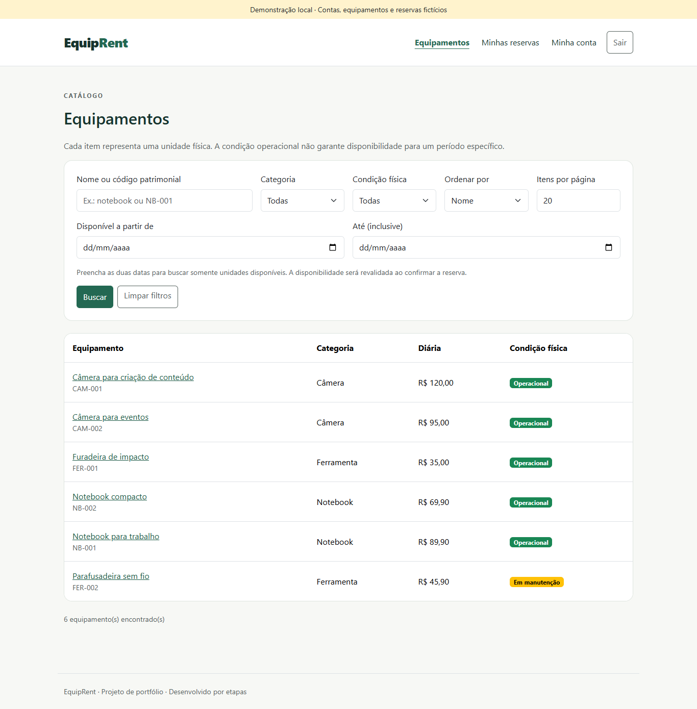
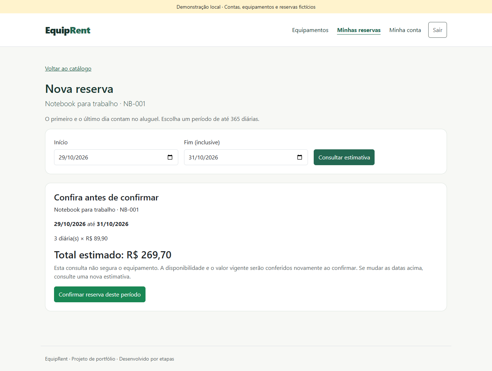
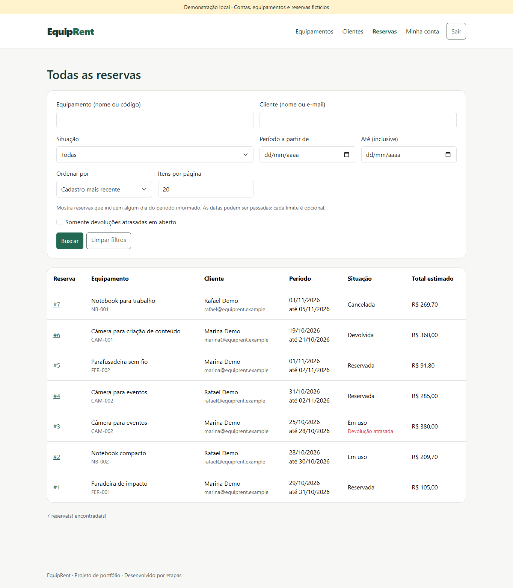
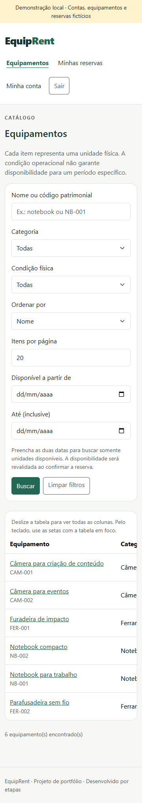
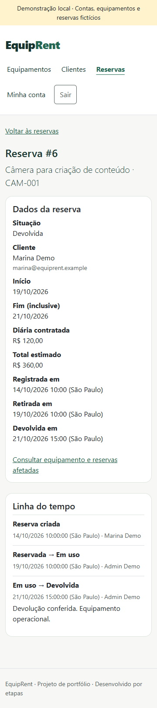
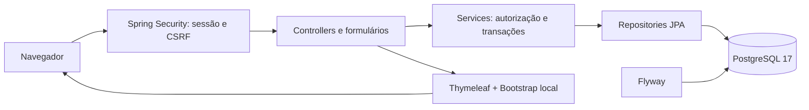

# EquipRent

Sistema web de aluguel de equipamentos para pequenas empresas. Organiza unidades físicas, reservas por período, retiradas, devoluções e histórico em um monólito **Java 21 + Spring Boot + PostgreSQL**.

Projeto de portfólio com foco em regras de negócio, autorização e consistência transacional. A interface usa Thymeleaf e Bootstrap local, sem build de frontend ou CDN.

[Demonstração local](docs/DEMONSTRACAO.md) · [Vídeo do fluxo e conflito](docs/media/equiprent-demo.webm) · [Guia técnico](docs/DESENVOLVIMENTO.md) · [Apresentação de 3–5 minutos](docs/APRESENTACAO.md) · [CI](https://github.com/cauacaetanofb/equiprent/actions/workflows/ci.yml)



## O que está implementado

| CLIENTE | ADMIN |
| --- | --- |
| Consultar catálogo e disponibilidade por período | Cadastrar equipamentos e clientes |
| Estimar diárias e confirmar uma reserva | Atualizar catálogo e condição física |
| Consultar somente suas reservas e histórico | Consultar todas as reservas e seus eventos |
| Cancelar reservas ainda não retiradas | Cancelar com motivo, registrar retirada/devolução |
| Acompanhar situação e valores contratados | Identificar atrasos, manutenção e compromissos afetados |

- Login por e-mail e sessão, senha com PBKDF2, CSRF e desativação de clientes com verificação de pendências.
- Dias inclusivos em `America/Sao_Paulo`, dinheiro com `BigDecimal` e snapshot imutável da diária/total.
- Bloqueio pessimista da unidade para impedir reservas sobrepostas, com reserva e evento na mesma transação.
- Atrasos calculados pela data de negócio; devolução antecipada ou tardia preserva o valor contratado.
- Busca, filtros, paginação, mensagens em português, foco nos erros e tabelas roláveis por teclado em telas pequenas.
- Perfil `demo` opcional com contas e dados fictícios, isolado do ambiente normal.

## Experimentar localmente

Pré-requisitos: **JDK 21**, Docker Desktop iniciado com contêineres Linux e PowerShell. O Maven Wrapper baixa o Maven necessário; internet é exigida no primeiro build/download de imagens.

Na raiz do projeto:

```powershell
java -version
.\mvnw.cmd -version
.\scripts\Start-Demo.ps1
```

Abra **http://localhost:8081**. O script cria `.local/demo.env`, inicia PostgreSQL em `5440` e executa o perfil `demo`. Não é necessário criar `.env` nem configurar o bootstrap do administrador para essa demonstração.

| Conta fictícia | Perfil |
| --- | --- |
| `admin@equiprent.example` | ADMIN |
| `marina@equiprent.example` | CLIENTE |
| `rafael@equiprent.example` | CLIENTE |

A senha das três contas é gerada localmente na variável `DEMO_ACCOUNT_PASSWORD` do arquivo `.local/demo.env`, ignorado pelo Git:

```powershell
notepad .\.local\demo.env
```

O script não exibe senhas nos logs. Reiniciar preserva registros, datas, senhas e ações realizadas. Para repetir a apresentação desde o começo, consulte [como recriar somente o banco da demo](docs/DEMONSTRACAO.md#reiniciar-ou-recriar-a-demonstração).

Use `Ctrl+C` para encerrar a aplicação. Para parar o banco da demo, preservando os dados:

```powershell
docker compose -p equiprent-demo -f compose.demo.yaml --env-file .local/demo.env down
```

Para usar seu banco de desenvolvimento em `8080`, siga o [guia de configuração com `.env`](docs/DESENVOLVIMENTO.md#configuração-e-execução-no-windows).

## Telas e demonstração

As capturas e o vídeo foram produzidos com o perfil `demo`, usando dados fictícios. O vídeo mostra uma estimativa consultada antes de outra sessão confirmar a reserva, a recusa da segunda confirmação, retirada e devolução com histórico.

| Reserva e estimativa | Administração |
| --- | --- |
|  |  |

| Catálogo em 360 px | Histórico em 360 px |
| --- | --- |
|  |  |

[Histórico desktop](docs/images/historico-desktop.png) · [Reserva mobile](docs/images/reserva-mobile.png) · [Administração mobile](docs/images/administracao-mobile.png) · [Vídeo WebM](docs/media/equiprent-demo.webm) · [Legendas em português](docs/media/equiprent-demo.vtt)

O vídeo é silencioso; as [legendas e o roteiro](docs/DEMONSTRACAO.md) descrevem as trocas de sessão e as decisões do fluxo.

## Arquitetura e decisões



O código é organizado por funcionalidade: `user`, `equipment`, `reservation`, `security` e `demo`. Controllers recebem formulários com campos permitidos; services revalidam perfil, atividade e propriedade. Hibernate apenas valida o esquema; Flyway aplica migrações. `open-in-view=false` exige carregar os dados necessários antes da renderização.

**Disponibilidade é uma consulta.** “Operacional” descreve a condição física, mas não garante que a unidade esteja livre no período. Reservas pendentes sobrepostas e uso atrasado bloqueiam novas confirmações.

**A confirmação protege a decisão.** A transação bloqueia cliente → equipamento; após esperar, recarrega os dados, revalida disponibilidade e registra reserva/evento atomicamente. Retirada, devolução e cancelamento compartilham o bloqueio de equipamento → reserva. A proteção funciona entre processos, sem depender de `synchronized`.

**Histórico é preservado.** Não há exclusão de registros de negócio; clientes são desativados e equipamentos aposentados. A edição da diária não muda contratos anteriores. As restrições SQL complementam os services, mas scripts externos ainda precisam respeitar o protocolo de escrita.

Tecnologias: Java 21, Spring Boot 4.1.2, Spring MVC/Security/Data JPA, Thymeleaf, Bean Validation, PostgreSQL 17, Flyway, Bootstrap 5.3.8, JUnit, MockMvc, Testcontainers e Maven Failsafe. Versões estão fixadas no projeto ou gerenciadas pelo parent Spring Boot.

## Testes e concorrência

Com Docker iniciado e a aplicação parada:

```powershell
.\mvnw.cmd clean verify
```

Nesta entrega, **276 testes passaram em JDK 21 efetivo**: 14 unitário/MVC e 262 de integração. Testcontainers inicia PostgreSQL 17 descartável, sem usar `.env` ou o volume de desenvolvimento. O perfil normal continua aplicando somente a V1; o marcador da carga demo é uma migração exclusiva desse perfil.

Para reproduzir somente a disputa simultânea por períodos sobrepostos:

```powershell
.\mvnw.cmd '-Dit.test=ReservationIT#shouldAllowExactlyOneOfTwoConcurrentOverlappingReservations' verify
```

O teste abre duas threads e transações reais, sincroniza o início e exige **uma confirmação, uma recusa, uma reserva e um evento**. O vídeo mostra a recusa de uma estimativa desatualizada; a concorrência simultânea é verificada por esse teste.

Para conferir a carga demo separadamente:

```powershell
.\mvnw.cmd '-Dit.test=DemoDataIT' verify
```

Os sete testes da demo cobrem consistência de preços/eventos/datas, idempotência e preservação de alterações, inicialização concorrente, recusa de banco inadequado/não vazio, senha ausente e rollback integral. A suíte também cobre autorização, CSRF, acesso por proprietário, limites monetários, meia-noite, falhas de evento e operações concorrentes. [Detalhes e resultados anteriores](docs/VALIDACOES.md).

[GitHub Actions](.github/workflows/ci.yml) executa a suíte com Java 21 em pushes para `main` e pull requests. Ações fixadas por SHA e relatórios Surefire/Failsafe guardados como artefatos. O estado remoto deve ser consultado na aba Actions; testes locais não comprovam a execução no GitHub.

## Limites e possíveis evoluções

Esta versão não inclui pagamento, multa automática, recuperação/troca de senha, cadastro público, reativação de clientes, carrinho, múltiplas empresas ou edição de datas de reservas. O cadastro de clientes é feito pelo ADMIN. Cancelar e reservar novamente mantém explícitos os novos valores e eventos.

A interface foi revisada em Chrome, desktop e 360 px, com teclado e auditoria axe; testes com outros navegadores e leitores de tela ainda não foram realizados. Não há implantação pública nesta entrega.

Evoluções possíveis: recuperação de acesso, notificações de atraso, política comercial de horários e observabilidade. Hospedagem exigiria configuração própria de TLS, segredos, backups e operação; o perfil demo é destinado à execução local.

## Documentação

- [Demonstração: dados, execução, roteiro e reinicialização](docs/DEMONSTRACAO.md)
- [Apresentação de 3–5 minutos e perguntas técnicas](docs/APRESENTACAO.md)
- [Configuração do ambiente normal, permissões e comandos](docs/DESENVOLVIMENTO.md)
- [Histórico das verificações](docs/VALIDACOES.md)
- [Planejamento, modelo e regras de negócio](PLANEJAMENTO.md)
